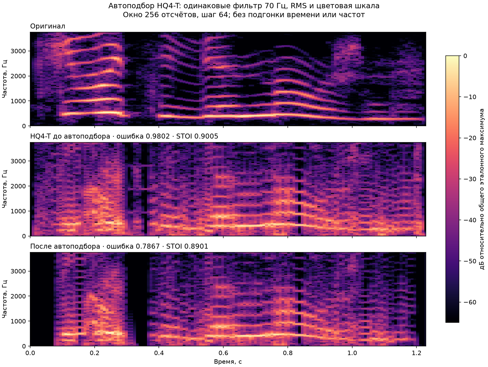

# Автоматический подбор HQ4-T

`tools/encode-hq4-auto.py` подбирает поток под **точный целочисленный декодер
ATtiny13A**, включая восстановление спектрального наклона HQ4-T. Синтез идёт
на компьютере; в прошивке нет алгоритма обучения, FFT или floating point.

## Что оптимизируется

Кодировщик сравнивает оригинальный WAV и декодированный PCM. Оба проходят
одинаковый Butterworth highpass 70 Гц второго порядка. Выход выравнивается
по RMS с оригиналом. Для окон Hann 128, 256 и 512 отсчётов с перекрытием 50%
вычисляются средняя абсолютная разность логарифмов модулей STFT и относительная
линейная спектральная ошибка. Цель: 80% первой ошибки + 20% второй, поровну
между окнами. Эталонные STFT рассчитываются один раз и переиспользуются.
Время и частоты не подгоняются. Формула и порог логарифма `.0005` заданы
в `auto_encoder.py`, класс `SpectralObjective`.

Такой критерий уменьшает расхождение спектрограмм на разных масштабах.
Он не является MOS/PESQ и не доказывает субъективное превосходство звука.
Полный оконечный тракт браузера не запускается для каждой пробы: сравнивается
точный PCM ЦАП после общего highpass. Итоговый HEX проверяется отдельно
через настоящий AVR-интерпретатор и JS/WASM-плеер.

STOI считается отдельно на исходном PCM, по той же методике, что исторические
отчёты HQ4. Порог `--floor` управляет компромиссом: 0,9005 сохраняет показатель
прежнего HQ4-T; например, 0,89 даёт поиску больше свободы для спектра.

## Что меняет поиск

- Восемь коэффициентов lattice, энергию, период и профиль возбуждения.
- Несколько параметров одновременно и общие изменения соседних кадров.
- Звонкость / шумовой режим.
- Границы кадров с сохранением точного общего числа отсчётов.
- Разделение и объединение кадров, если это допускает Flash.

Несколько поисковых цепочек с охлаждением стартуют от лучшего результата.
Половина проб также проверяет его окрестность непосредственно, чтобы поиск
не застревал в области с недопустимым STOI. Рабочая цепочка может временно
снизить STOI на величину до 0,02 с явным штрафом. **Экспортируется только
лучший допустимый результат**, с STOI не ниже заданного порога.

Ограничения: код + поток + маркер ≤1024 байта, пик ≤115 знаковых отсчётов,
нет шагов PCM ≥48 отсчётов на первом проходе. На поток остаётся максимум
601 байт при декодере 422 байта. Исходный поток должен уже выполнять эти
ограничения и порог STOI. Это дообучение существующего потока; первичный
анализ совершенно новой записи без начального потока здесь не реализован.

## Запуск и продолжение

Зависимости: `requirements.txt`; для графиков дополнительно `matplotlib`.
WAV: моно, 7500 Гц, длина точно равна сумме длительностей начального потока.
Исходную запись держать вне отслеживаемых файлов Git. Кодировщик записывает
SHA-256 записи, начального потока и исходников алгоритма в отчёт.

```text
python tools/encode-hq4-auto.py --reference C:/external/chego-original.wav --output build/auto --proposals 40000 --floor 0.9005
python tools/encode-hq4-auto.py --reference C:/external/chego-original.wav --output build/auto --proposals 80000 --floor 0.9005 --resume build/auto/checkpoint.json
```

По умолчанию стартует от сохранённого HQ4-T «Чего тебе нужно?». Для другого
потока укажите `--input-stream`. Число `--proposals` — общий предел с учётом
продолженной работы, включая пробы, отброшенные до синтеза.

`--seed`, `--floor`, `--restart-every` и `--temperature` при продолжении должны
совпадать. Период охлаждения не зависит от общего бюджета: остановка и
продолжение воспроизводят непрерывный запуск. Проверяются хеши входов и
исходников, а сохранённые оценки пересчитываются перед возобновлением.
Если алгоритм изменился, начните новый поиск от лучшего `speech.hq`.

Каждые `--checkpoint-every` проб (по умолчанию 500) сохраняются:

- `checkpoint.json` — рабочая цепочка, лучший поток и состояние генератора RNG;
- `speech.hq` — лучший допустимый поток;
- `training.json` — критерий, ограничения, версии библиотек и история улучшений;
- `expected.raw`, `decoded.wav` — временные результаты для проверки и прослушивания.

JSON контрольной точки заменяется атомарно. После прерывания процесс можно
продолжить с последней сохранённой точки. Бюджет и seed не дают гарантии
глобального оптимума: сохраняется лучший вариант среди проверенных.

## Проверки

```text
python tools/test-hq4-auto.py
python tools/report-hq4-auto.py --reference C:/external/chego-original.wav --candidate build/auto/speech.hq --output build/auto-comparison --plot
```

Тесты проверяют независимость спектральной цели от уровня, чувствительность
к потере деталей, сохранение длительности при изменении структуры кадров,
ограничение Flash, неизменность лучшего допустимого результата и точное
совпадение продолженного и непрерывного поиска.

Отчёт сравнения создаёт спектрограммы с общей шкалой, метрики и WAV
«оригинал → HQ4-T → оригинал → Auto» с одинаковыми highpass/RMS/масштабом пика.
Исходный HQ4 и HQ4-T для этого демонстрационного отчёта берутся из сохранённых
вариантов `chego`; общий кодировщик не привязан к их WAV или хешу.

## Проверенные результаты 2026-10-23

Для каждого режима проверено 60 000 предложений; после 40 000 поиск успешно
продолжен из контрольной точки. Эталон — канонические 9216 отсчётов `chego`.

| Вариант | Ошибка лог-спектра | STOI | Flash |
|---|---:|---:|---:|
| Прежний HQ4-T | 0,98023 | 0,9005003 | 979 Б |
| Auto, порог 0,9005 | 0,93595 | 0,9005001 | 1007 Б |
| Спектр, порог 0,89 | 0,78670 | 0,8900731 | 979 Б |

Снижение ошибки относительно прежнего HQ4-T: 4,52% и 19,74%. Это относительное
изменение данной спектральной метрики, не процент улучшения воспринимаемого
качества. Общий критерий (с линейной составляющей) улучшился на 3,87% и 17,81%.
Все результаты оптимизированы на этой же записи.

Сохранённые источники и отчёты:

- `timbre/chego-auto/`: поток, история обучения, метрики, спектрограммы и AVR-проверка;
- `timbre/chego-spectrum/`: тот же набор для более свободного порога;
- общая прошивка: `timbre/chego/firmware.S`, декодер 422 байта.

Для каждого нового потока все 27 648 отсчётов трёх повторов совпали в численной
модели, JS, WASM и WASM без оптимизаций. Потерь таймера и пропусков отсчётов
нет; физический чип не измерялся. Пересборка: `tools/build-hq4-timbre.py`
с `--variant chego-auto` или `--variant chego-spectrum`.

Для точного повторения Auto используйте seed 23062 и порог 0,9005; для
«Спектр» — seed 23063 и порог 0,89. Остальные настройки CLI стандартные.
Временные WAV, PCM и контрольные точки остаются в игнорируемом `build/`.



Следующий шаг к исходной форме голоса описан в [CLOSER_TO_ORIGINAL.md](CLOSER_TO_ORIGINAL.md).
