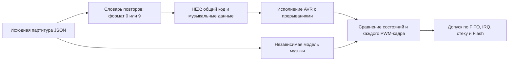

# Проверка общего UM88 для ATtiny88

Текущая проверка охватывает все девять сохранённых композиций на двух платах: отдельный ATtiny88 8 МГц и MH-ET LIVE Tiny88 16 МГц с Micronucleus. Моно и стерео используют общий исполняемый код внутри каждого профиля. Измерения относятся к цифровой модели с активными прерываниями; физическая плата и реальная USB-загрузка не использовались.

## Независимый эталон

Исходный `score.json` остаётся распакованным. Он содержит команды всех голосов, формы волн, контексты инструментов, огибающие, палитру высот и длительность. Проверяется его равенство сохранённой версии `ad018dc`; смена платы и упаковки не удаляет команды, ноты или партии.



Эталон `tools/universal-reference.mjs` читает исходный JSON, а не бинарный словарь или таблицы прошивки. Полный аудитор сверяет управляющие кадры, уровни и контексты каждого голоса, фазы DDS до/после микса, кеши форм волн, шум/ударные, четыре интерполированные точки и реальные значения OCR после IRQ. Проверяются полный цикл и начало повтора, непрерывность FIFO, потери прерываний и минимальный SP.

[Все 18 образов](reports/all-boards-verification.json) связаны с реальными SHA-256 ROM, общего кода, партитур и распакованных команд. Каталог плеера дополнительно проверяет размер, HEX/BIN, одинаковый код девяти мелодий, исходники сборки и соответствие отчётов образам. У USB проверяются предел 6012 байт, пустая EEPROM, унаследованные WDT/PRR/стек и сохранение штатных фьюзов.

## Сжатие и часы

Оба словаря сохраняют повторяющиеся фразы, аккорды, несколько голосов, паузы и фазовые команды. `--packing auto` выбирает компактные девятибитовые ссылки при кольце 192 байта и быстрые выровненные пары при меньшем кольце. Явные `compact` и `fast` доступны отдельно; качество и исходные команды одинаковы.

20 тестов кодека/формата включают все девять партитур в обоих словарях, полную повторяемую трёхголосную аккордовую фразу, 256 терминалов, последний код 511, глубину 12, переходы между байтами, повреждённые ссылки и остаточные биты. Отдельно проверены 88 скомпилированных граничных случаев обоих форматов и восемь сценариев порядка управления (C/ASM, обе частоты): [8 МГц](reports/packed-decoder-8mhz.json), [16 МГц](reports/packed-decoder-16mhz.json).

Короткие счётчики используют точные сокращённые дроби, сохраняя каждую границу музыкального тика и перенос продвижения ударных. Для прочих частот остаётся широкая арифметика. Компиляторные тесты проверяют типы/периоды при 8/12/16 МГц; 90000 шагов совпадают с прежним алгоритмом. Полное исполнение дополнительно сверяется с независимыми исходными часами эталона.

## Полифония и память

[Матрица нагрузок](reports/admission-all-boards.json) содержит положительные и отрицательные результаты. ASM проходит плотную смену трёх, шести и восьми голосов при 8 МГц, восьми при 12 МГц и длинный стресс на 256 тиков. C после оптимизации проходит выбранные удерживаемые 1–8 голосов; восьмиголосный случай сохраняет минимум 67 кадров FIFO. Это не допуск произвольной C-партитуры. Пачка 1200 CONTEXT отвергается, даже если словарь хорошо её сжимает. Намеренно неверные ударные и выходной gain обнаруживаются аудитором.

[Проверка буферов](reports/buffer-verification.json): плотные восемь голосов проходят с 128 и 192 байтами, 64 — недостаточно; выбранной одноголосной петле недостаточно 8 байт. Явные компактный и быстрый варианты этюда проверены отдельно с одинаковым JSON и хешем распакованных команд. Это свойства измеренных нагрузок, а не гарантия произвольного MIDI.

Кольцо занимает 192 байта по умолчанию: 192 моно-кадра либо 96 стереопар. Общий код возвращает signed16 L/R в `uint32_t`; IRQ потребляет один либо два байта. C/ASM проверены на 16992 независимых миксах, 34816 вариантах кеша волн и 576 моно/стерео IRQ-состояниях на каждый backend и частоту: [методика и результаты](reports/BACKEND_ALL_BOARDS_RU.md). Включены знаковые границы, панорама, group gain, ABI, SREG, ненулевой r1 в IRQ, wrap и empty. C-стерео арифметически эквивалентно, но не выдерживает реальное время выбранного профиля и не публикуется как поддержанный вариант.

[Моноэтюд](examples/mono-study/README.md) полностью проверен при 8/12 МГц, [восьмиголосный этюд](examples/polyphony-study/README.md) — с кольцами 128/192. Их исходные события, ноты/хвосты и длины WAV сохранены. Для новых пакетов требуется отсутствие клиппинга; прежнее ограничение пиков rhythmic сохранено и явно отражено в отчётах.

## Воспроизведение проверок

```text
python tools/test-universal-codec.py
python tools/test-universal-format.py
python tools/test-universal-clock.py
python tools/test-universal-clock-ratios.py
python tools/test-universal-boards.py
python tools/test-universal-buffer.py
python tools/test-universal-admission.py
python tools/test-arrange-universal-music.py
python tools/test-compile-universal-music.py
node tools/audit-universal-music.mjs
node tools/audit-universal-music.mjs --directory=ATtiny88/Music/universal/songs-micronucleus
python web-player/scripts/build_catalog.py --target attiny88 --check
python web-player/scripts/build_catalog.py --target attiny88 --board mh-et-live-16mhz --check
node --test web-player/tests/universal-music.test.mjs web-player/tests/universal-board.test.mjs web-player/tests/universal-package.test.mjs web-player/tests/board-select.test.mjs
```

Полный цикл создания пакета проверяет внешний временный MIDI, сохраняет структурированные события и исходный SHA-256, удаляет MIDI после теста и публикует результат только после аудита. Проверки включают темп, начальную паузу, педаль, программы, volume/expression, pitch bend, порядок одинаковых нот, отчёт сокращений и отказ при клиппинге/нехватке времени.

Исторические исследования предыдущих моно-версий: [полифония](reports/polyphony-optimization.json), [прежняя матрица](reports/admission.json), [профиль 8/12 МГц](reports/mono-clock-comparison.json), [аудит алгоритма из соседнего чата](reports/algorithm-review.json). Их числа относятся к записанным там исходникам и хешам. Исторический Greensleeves можно сравнить по [фрагментам и происхождению](reports/listening/comparison.json); это не автоматическая оценка слухового качества.
