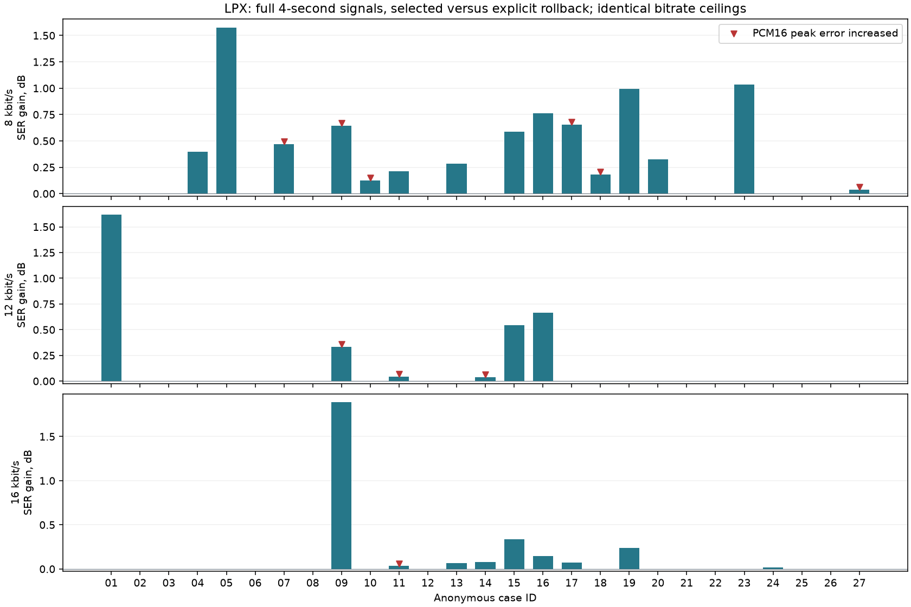

# Выбор профилей и ускорение PC encoder

Этап завершён по [плану](../../PROFILE_DEVELOPMENT_PLAN_RU.md).
Основные направления: speech v5 enhanced для4/6; старый v2/v3 compact24 с
более сильным PC поиском для8/12/16. Развитие v5/Flash остаётся в отдельном
чате. Для8 приоритет — слабые случаи,12 — баланс,16 — приоритет качества.
Два ускорения PC encoder сохраняют его результат; отдельный quality run
использует более сильный поиск при прежней грамматике распаковки.
Корпусы и реальные битрейты не смешиваются при сравнении.

## Раунд1: единый целочисленный LPC trace

Старая host-модель вызывала малые JIT cdiv/clamp из Python десятки тысяч
раз за4 секунды. Профилировщик заметно увеличивает цену этих вызовов;
поэтому отдельно проверены обычные wall clocks без профилировщика:
median trace0,506s, quantize_joint1,162s, весь joint call2,615s на одном
предварительном речевом опыте. Trace вычисляется также в независимой
проверке decoded PCM. Эти предварительные clocks не являются основным
парным сравнением и не используются как универсальный benchmark.

Новый q0_model.coefficient_trace разбирает frames с прежней проверкой,
затем вычисляет весь trace в одном integer JIT kernel. Нет fastmath,
floating-point коэффициентов, иной квантовки или иных округлений.
Исходная реализация доступна как coefficient_trace(...,reference=True).
Изменён только Python-инструмент: firmware, C/ASM, таблицы и format прежние.

При LSF0..1023 cosine остаётся в[-8192,8192]. Промежуточные полиномы
соответствуют degree<=11 произведениям bounded second-order factors;
грубая l1-оценка8192*4^5 составляет8388608 до ошибок округления. Даже с
запасом на эти округления int64 имеет большой запас для произведений.
Выходные коэффициенты насыщаются ровно
как раньше. Frozen extremes включают в том числе неупорядоченные модельные
векторы, близкие корни и переключения0/1023, не только обычные голоса.

## Парное измерение полного fixed-lambda вызова

Три одинаковые полные PCM16 mono/8kHz записи по32000 samples. По3 повтора
before/after, порядок чередуется в одном процессе; возвращённые encoded,
PCM16 и PWM hashes проверяются каждый раз. Encoded-output cache не
используется. JIT/warmup измеряется отдельно и не входит в warm medians.
Старые joint_rate.py и q0_model.py извлечены из d1e8984e и hash-pinned;
старый joint явно привязан к старой модели, чтобы baseline не ускорялся
нечаянно вместе с новым модулем.

| Входной seed | Lambda | Полный выход, бит/с | Median before,s | after,s | Меньше времени |
|---|---:|---:|---:|---:|---:|
| 8, речь | 0,1 | 10122 | 2,2544 | 1,2458 | 44,74% |
| 12, речь | 0,03 | 8378 | 2,2482 | 1,2384 | 44,92% |
| 16, музыка | 0,01 | 11680 | 2,3611 | 1,3329 | 43,55% |

Столбец seed — семейство входного потока, не достигнутый потолок.
Это один полный joint evaluation при фиксированной lambda, а не вся
CLI-команда с rate search, анализом исходного WAV и всеми proposals.
Именно такие вызовы повторяются внутри поиска, но экономия времени
всего CLI должна измеряться отдельно. Наблюдение относится к текущему
Windows host, библиотекам и трём примерам; переносимость числа не заявляется.
Неизменённый trellis в microcontrol колебался примерно на2,3%; ускорение
самого trellis в этом раунде не заявляется.

## Точность и воспроизводимость

- 52 traces сравниваются с frozen hashes старой модели и явно выбранным
  Python reference: tail lengths, all-equal/extreme/clustered/random LSF.
- 300 frozen trellis cases: beam1/4/8, direct/Rice/Huffman/pitch/sparse,
  короткие хвосты, saturation, состояния и все возвращённые поля.
- 111 golden points,91 уникальный поток/2912000 уникальных samples:
  trace fast/reference точен, native/model PCM16 и PWM совпали с frozen
  corpus. Дубликаты golden points не выдаются за новые независимые потоки.
- Полный host suite122:121 passed/1 optional hard-link skip.
- Прежние AVR measurements не переизмерялись как будто это новое ускорение
  MCU: decoder и созданные сравниваемые streams побитово прежние.

[Парные времена](speed-coefficients.json), [golden validation](validation-coefficients.json).
Команда benchmark_encoder_speed.py принимает frozen baseline source+SHA,
локальный manifest reference/seed paths и файл JSON-результата; старый
q0_model_reference.py лежит рядом с joint_rate_reference.py. Исходники
baseline следует извлечь из указанного коммита. Все audio/input manifests,
runtime caches и логи остаются в ignored build/lpx-profiles/.

## Раунд2: рабочие массивы и префиксы trellis

Candidate arrays выделяются один раз на вызов trellis и переиспользуются.
Каждая читаемая ячейка перезаписывается до чтения. Хранятся только уже
инициализированные q-prefix: future columns не могут участвовать в pitch
recursion, где обращение всегда к прежнему sample. Порядок proposals,
tie-breaking, арифметика, beam и все coding costs прежние. Ненужный scores
array удалён. Это ускорение поиска, не изменение глубины/качества поиска.

Все300 frozen состояний/выходов совпали, включая invalid paths и clipping.
Targeted suite5/5 прошёл. В каждом парном full encode снова совпали encoded,
PCM16 и PWM hashes. Microbenchmark trellis требует примерно на64,9% меньше
времени на текущем наборе. Изолированный full joint опыт использует новый
LPC model с обеих сторон (--baseline-model current), меняя только trellis:

| Seed family | Before,s | After,s | Меньше времени |
|---|---:|---:|---:|
| 8 | 1,9515 | 1,0522 | 46,08% |
| 12 | 2,2115 | 1,2200 | 44,83% |
| 16 | 2,4993 | 1,3100 | 47,59% |

Совместное сравнение обоих улучшений с исходными двумя модулями показало
68,43..72,30% меньшего warm времени, примерно3,2..3,6x. Абсолютные времена
разных запусков меняются при нагрузке Windows host: сравнивать нужно
парные before/after, не делить числа из разных опытов. JIT startup и весь
target-rate CLI по-прежнему не входят в эти warm single-call claims.

[Совместный опыт](speed-trellis.json), [изолированный trellis](speed-trellis-isolated.json).
Ограниченный поиск качества с beam8 и совместимыми seeds завершён ниже.

## Полный ограниченный поиск, а не один вызов

На полном четырёхсекундном речевом `case-08` проверен весь `search_budget`:
два seed 12/16, полный cap 6020 байт, lambda 0,01/0,03/0,1, два refinement
trials на seed, beam4, десять encoder evaluations на поиск. В двух парных
повторах с чередованием порядка median **24,319 → 7,313 с**, на **69,93%**
меньше времени, **3,33×** быстрее. Совпали все предложения, их ошибки,
выбранные bytes и полный PCM. Это выигрыш без изменения качества поиска.

Повтор воспроизводимым `benchmark_encoder_search_speed.py` отдельно
проверяет ещё и PWM: median 25,727 → 8,306 с, −67,72%, 3,10×.
Скорость зависит от
нагрузки Windows host. Чтение WAV, построение native DLL, cold startup и
JIT не входят в тёплое время. Полная CLI-команда и новый более глубокий
beam8 quality run не объявляются в 3,33 раза быстрее всей старой команды.
[Исходный полный опыт](speed-full-search.json),
[повтор с сохраняемым инструментом](speed-full-search-reproduced.json).

## Качество: все 27 полных записей и 81 точка

Корпус: 16 чистых речевых, две тихих, две шумных речевых записи,
три акустических музыкальных и четыре синтетических сигнала.
Каждый — 32000 samples, mono/8 кГц/PCM16, без сдвига или подгонки gain.
Потолки audio payload 8/12/16 кбит/с соответствуют полному cap
4020/6020/8020 байт: header добавляет 40 бит/с на четырёх секундах.
Потолок не означает, что каждый выход обязан заполнить весь файл.

12/16 baseline — прежний enhanced multiseed; для 8 только пять точек
исторические. Для остальных 22 сначала создан допустимый beam4 baseline,
который явно помечен в данных. Нельзя считать эти 22 сравнения улучшением
над ранее выпущенным 8-кбитным результатом для того же образца.

Новый bounded beam8 search использует rollback, соседние bitrate seeds,
а для четырёх прежних голосов — точные v5 enhanced → v2/v3 transcodes.
Синтез этих seeds не меняется. Выбирается только поток, который проходит
cap и полные **PCM16 и реальный PWM SSE/STOI floors** против своего baseline.
При неудаче сохраняется baseline. Новых decoder modes, таблиц и ручного ASM
нет. CLI с теми же ограничениями:
[refine_bitrate_profile.py](../../01_ACTIVE_Q0_CODEC/tools/refine_bitrate_profile.py),
[применение](../../01_ACTIVE_Q0_CODEC/tools/PROFILE_REFINEMENT.md).

| Потолок payload, кбит/с | SERΣ, дБ, до → после | STOI речи, до → после | Меньше SSE / всего | Полный средний битрейт, бит/с, до → после |
|---|---:|---:|---:|---:|
| 8 | 11,4508 → 11,8551 | 0,72478 → 0,74409 | 15/27 | 7225,1 → 7350,9 |
| 12 | 16,7509 → 16,8908 | 0,82696 → 0,82922 | 6/27 | 11075,9 → 11105,9 |
| 16 | 20,0097 → 20,0557 | 0,89305 → 0,89484 | 10/27 | 14846,8 → 14838,1 |

SERΣ = 10 log10(суммарная энергия reference / суммарная энергия ошибки),
а не среднее индивидуальных дБ. STOI усредняется по 20 речевым записям.
Рост среднего bitrate у 8/12 означает использование свободного места
в прежнем cap; улучшение при неизменном фактическом размере здесь не обещается.
Все 81 точки прошли оба floors; у остальных 50 результат сохранён.

Для 16 чистых голосов SERΣ: 10,3488 → 10,8258 / 16,4044 → 16,5686 /
20,1782 → 20,2557 дБ. Для пяти исторических 8-точек улучшились две:
SERΣ 10,1350 → 10,2975, STOI 0,76085 → 0,77694, полный средний bitrate
7994 → 7988 бит/с. Для 22 новых 8-baselines улучшились 13:
SERΣ 11,9710 → 12,4982, STOI 0,71576 → 0,73587 при 7050,4 → 7206,1 бит/с.
Тихие записи дали заметный прирост на 8; шумные — небольшой на 8;
для тихих/шумных 12/16 прежние точки сохранены. Музыкальные и синтетические
группы доступны отдельно в JSON; музыкальная универсальность не заявляется.

Пик не входит в floors: он вырос в **6/3/1** точках PCM16 для 8/12/16
и в **4/4/1** PWM-точках. Общий максимальный PCM16 пик корпуса:
11105 → 11105 / 6925 → 6925 / 5361 → 4177. Меньшая средняя ошибка
не гарантирует уменьшения каждого выброса. Человеческие оценки не собирались.

Цена quality run сохранена отдельно от speed benchmark: 1500 новых
evaluations и 163 проверенных cache hits; суммарно 1699,6 с case wall times
при трёх параллельных process shards, с resumable cache. Это не CPU-time
и не независимое парное измерение ускорения; прежнее и новое качество
не сравниваются на одинаковой цене поиска.



Неизменённые идеально восстановленные сигналы с нулевой ошибкой показаны
нулевым приростом, без вычитания бесконечных SER.

[Сводка и группы](summary.json), [все точки](measurements.json),
[таблица CSV](measurements.csv). Сохранены hashes, caps, SSE/STOI,
максимальные отклонения и source selection каждого результата.

## AVR: качество допускается только после полного воспроизведения

ATmega328P, AVR5 с MUL, GNU ABI, AVR-GCC 7.3.0, simavr, 16 МГц / 8 кГц,
queue512/prefill384, LPC segments2. Общий арифметический backend явно
включён `LPX4_ENABLE_ASM=1`; C остаётся независимо выбираемым на AVR.
Flash access и реальные target defines сохранены. Утверждения относятся
к симуляции, а не к физической плате или любому будущему потоку.

Обычный unroll9/tuning7 рецепт проверен для всех 162 before/after points:
107 уникальных полных ELF. После объединения опубликованного main отдельно
доказано равенство preprocessed legacy C/ASM tokens; эти default measurements
сохранены с исходными hashes и не выдаются за новые сборки другого исходника.
Свежая финальная native/model проверка заново воспроизвела все 162 WAV.

Рецепт из соседнего speech Flash этапа повторно измерен на legacy:
`-Os -flto -mcall-prologues -mrelax`, unroll1/tuning0,
speech=0/compact=0/COMPACT_ONLY=0, v3 features24. Все 81 selected points,
77 уникальных полных ELF, точный полезный PWM, **0 underruns**.
Программа с harness, startup и таблицами, без точного аудиомассива:
**6512–6514 байт**, static SRAM **1102 байта**. ABI измерителя сохранён;
минимальный наблюдённый stack margin после ready — 828 байт.

| Потолок | Средние decode wall cycles, unroll9 → компактный рецепт | Доля бюджета 2000 cycles/sample |
|---|---:|---:|
| 8 | 804,628 → 705,270 | 35,26% |
| 12 | 835,160 → 730,176 | 36,51% |
| 16 | 865,255 → 753,662 | 37,68% |

Это интервалы работы decoder с активными IRQ и instrumentation, не общий
процент загрузки приложения. Для тяжелейших точек каждого bitrate в обеих
сборках проверены непрерывные 64000 samples: normal, +100 cycles/audio IRQ
и C fallback, всего 18 controls. Все ASM normal/+100 без пропусков;
компактные +100: 863,919 / 827,515 / 850,648 средних cycles/sample.
C полезные значения точны, но 3164–3196 cycles/sample и underruns:
real-time для него не заявляется. Stack startup/worst-case не доказан.

[Обычные AVR](default-avr.json), [компактные AVR и long controls](small-avr.json),
[обычные long controls](default-stress.json),
[равенство tokens при интеграции main](default-token-equivalence.json),
[неизменность прежних common compiler commands](factory-default-flags.json),
[повторно используемый рецепт и ограничения](../../../../docs/avr-asm-cookbook/lpx-program-flash.md).

## Окончательный выбор профилей

| Bitrate | Предпочтительный профиль | Назначение |
|---|---|---|
| 4 | speech v5 enhanced + explicit compact-only small-code | Минимальный речевой размер; четыре проверенных голоса |
| 6 | speech v5 enhanced + explicit compact-only small-code | Более качественный компактный речевой вариант |
| 8 | legacy v2/v3 compact24 + guarded beam8 | Экономный совместимый вариант; сначала оценивать слабые речевые места |
| 12 | legacy v2/v3 compact24 + guarded multiseed beam8 | Основной баланс размера и качества |
| 16 | legacy v2/v3 compact24 + guarded multiseed beam8 | Приоритет качества, дальнейший выигрыш этого поиска небольшой |

4/6 используют отдельный четырёхголосый корпус и завершённый
[speech Flash отчёт](../speech-flash-2026-10-26/README.md): 5909–5910 байт
программы без аудио, static SRAM1085, точный PWM, IRQ admission.
Его средние качества нельзя напрямую ранжировать с этим 27-case corpus.
При смешанном наборе форматов требуется общий parser и другой размер;
compact-only нельзя включать для legacy 8/12/16. Публичные CLI defaults
не заменяются автоматически; улучшение существующего потока включается явно.

## Проверка и воспроизведение

Функциональный suite объединённого кода: **133 теста, 132 passed,
один optional hard-link skip**. Frozen 52 traces и 300 trellis states
точны, golden 111 points / 91 unique streams сохранены. Новые инструменты
полного search benchmark и final audit отдельно запущены до сохранения отчёта.
[Проверки](tests.json). Необезличенные input manifests, аудио, ELF, кеши
и runtime logs остаются в ignored `build/lpx-profiles/`.

Производитель quality corpus — `22a7f722`; финальное decoder admission
после интеграции main — `5600934b`, с точными source hashes в JSON.
Для побитового повторения прежней production revision следует брать
производящие tools/src из producer commit. Новая raw source revision после
интеграции не подменяет прежний cache fingerprint.

Из корня репозитория с tools в PYTHONPATH и доступными g++/AVR-GCC/simavr:

```text
python Codecs/LPX/01_ACTIVE_Q0_CODEC/tools/benchmark_profile_development.py INPUTS.json build/lpx-profiles/quality
python Codecs/LPX/01_ACTIVE_Q0_CODEC/tools/validate_profile_development.py run INPUTS.json build/lpx-profiles/quality build/lpx-profiles/avr --avr-bin AVR_BIN --runner SIM_RUNNER --lib SIM_LIB
python Codecs/LPX/01_ACTIVE_Q0_CODEC/tools/validate_profile_development.py stress build/lpx-profiles/avr build/lpx-profiles/quality build/lpx-profiles/stress --avr-bin AVR_BIN --runner SIM_RUNNER --lib SIM_LIB
python Codecs/LPX/01_ACTIVE_Q0_CODEC/tools/validate_profile_smallcode.py build/lpx-profiles/quality build/lpx-profiles/avr-small --avr-bin AVR_BIN --runner SIM_RUNNER --lib SIM_LIB
python Codecs/LPX/01_ACTIVE_Q0_CODEC/tools/summarize_profile_development.py INPUTS.json build/lpx-profiles/quality build/lpx-profiles/avr build/lpx-profiles/avr-small build/lpx-profiles/stress build/lpx-profiles/final --producer 22a7f722
```

INPUTS cases содержат anonymous id/kind/group, reference/path+hash,
старые rate/path seeds и признак historical8; схема читается в producer.
Без исходных локальных записей retained hashes и CSV позволяют проверить
выводы отчёта, но не реконструировать приватную волну. Публикации аудио нет.
Для speed baseline извлечь `joint_rate.py` и `q0_model.py` из `d1e8984e`
в `joint_rate_reference.py` / `q0_model_reference.py`; SHA указан в speed JSON.
Search speed manifest: id, reference/reference_sha256, seeds[{path,sha256}],
cap_complete_file_bytes, kind, lambdas, refinement_trials_per_seed, beam.

Локальная страница `build/lpx-profiles/listening/index.html` содержит семь
сборников по 17,5 с (original и before/after 8/12/16), а также все 27 записей
отдельно. Четыре фрагмента по 4 с и паузы по 0,5 с, gain/сдвиг не менялись;
полные PCM16 tracks проверены после записи. Это PCM, не аналоговый выход AVR.
[Порядок и hashes сборников](listening.json).
