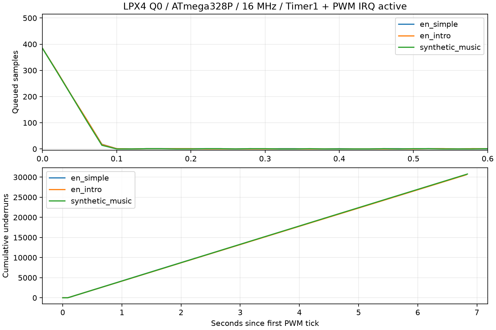

# LPX4 Q0: продолжение плана оптимизации, 25.10.2026

Добавлен самостоятельный WAV-кодировщик и выполнены первые эксперименты
A1/A2/B3 без изменения C++-декодера или формата L4HY v2. На новых данных
обнаружена и устранена проблема неустойчивых квантованных LPC-кандидатов.
Проверка полного AVR-проигрывателя выявила дефицит CPU: проверенный профиль
ATmega328P 16 МГц / 8 кГц **не проходит**, несмотря на достаточные Flash/SRAM.

## Что выполнено по плану

| Этап | Результат |
| --- | --- |
| Freeze baseline | Две прежние тренировочные фразы воспроизведены C++ PCM16; SHA WAV/потоков/PCM и метрики сохранены |
| WAV→LPX4 | Автоматический LPC/LSF-анализ, целочисленный closed loop, реальный byte cap, независимые сегменты до 65 535 Б |
| A1 delayed decisions | Beam 1/4/8/16, окна 20/40, хвост 80, только слова прежней длины, нативная проверка каждого кандидата |
| A2 совместный поиск | 1–4 чередующихся прохода LSF / beam / Q14 с глобальными SER/STOI и byte gates |
| B3 старт анализа | Исходный LPC, bandwidth expansion 0,90 и нейтральный старт; проверка полюсов действительных Q12 коэффициентов |
| Незнакомые данные | Четыре внешних речевых файла (RU/EN) и отдельная синтетическая музыка, первые ≤3 с |
| AVR | Полный ELF/HEX, настоящий AVR-LibC, активные Timer1/Timer2/IRQ, очередь, стеки и побайтовая проверка PWM в simavr |
| Opus/AAC/LPX3 | Подбор по фактическим полным размерам контейнеров, общий byte cap, без подгонки задержки или усиления |

Все 32 unit-теста прошли за 36,220 с. Включены 22 прежние регрессии,
16 генерируемых потоков C++/целочисленная модель, короткий хвост, тишина,
ресэмплинг, сегментация, детерминизм, ошибочный бюджет, неустойчивый фильтр,
парная замена при неуспехе жадного поиска и сохранение стоимости декодирования.
[Окружение и SHA новых инструментов](environment.json).

## Улучшение начального кодирования при прежнем размере

Для каждого файла верхний предел зафиксирован по фактическому размеру
первого WAV-кодировщика `df2b28a` (исходный ориентир ≤24 кбит/с).
Новые старты не получают дополнительных байтов. Из допустимых кандидатов
выбирается минимальная полная PCM16-ошибка; STOI исходного допустимого
LPC-кандидата для речи снижаться не может. Громкость и задержка не подгоняются.

| Вход | Отсчёты | Байты до → после | SER до → после, дБ | STOI до → после |
| --- | ---: | ---: | ---: | ---: |
| en_simple | 11200 | 4176 → 4146 | 31.993 → 32.570 | 0.970942 → 0.979350 |
| ru_kak | 8000 | 2957 → 2895 | 24.279 → 25.799 | 0.991969 → 0.993253 |
| en_intro | 24000 | 8616 → 8616 | 13.065 → 13.065 | 0.966168 → 0.966168 |
| ru_sayings | 24000 | 8213 → 8213 | 26.073 → 26.073 | 0.911393 → 0.911393 |
| synthetic_music | 24000 | 8018 → 6410 | -3.410 → 11.230 | — |

SER — мощность исходного PCM к мощности полной ошибки реконструкции,
после LPC/de-emphasis/postfilter, до PWM. Это не аналоговый SNR и не
численная точность фильтра. Для музыки STOI не применяется.

Исходный музыкальный анализ имел полюса интерполированных квантованных
коэффициентов вне единичной окружности (максимум ≈1,102), хотя исходный
float-LPC был устойчив. На этом входе небезопасный старт отклонён;
нейтральный старт дал 11,230 дБ вместо −3,410 дБ и меньший файл.
Проверка отдельных фиксированных фильтров не доказывает общую устойчивость
произвольной последовательности их переключений; финальный PCM также
проверяется нативным декодером.

Для `en_intro` один из новых стартов улучшал SER, но снижал STOI, поэтому
был отклонён. Сохранение ограничений важнее выбора одной привлекательной
метрики. Два других улучшения речи достигнуты при росте обеих метрик.

[Исходный сравнительный прогон](baseline-before-stable-restarts.json),
[полный новый прогон](benchmark.json).

## A1/A2: результат поиска

При лимите 1000 проб на конфигурацию большие beam не дали устойчивого
преимущества над beam=1 на реальной речи. Отдельная регрессия подтверждает,
что beam=4 находит полезную согласованную пару изменений, когда одиночные
замены ухудшают результат. На корпусе получены лишь малые дополнительные
приращения SER. При одинаковом лимите проб широкий beam посещает меньше
окон; это не исчерпывающая проверка delayed-decision идеи.

На двух прежних тренировочных фразах 4931/4047 Б исходные SER повторились:
32,366959 / 30,590919 дБ. Два прохода LSF/beam/header практически их не
изменили. Размеры и нативные счётчики bit calls / ROM reads / LSF conversions
сохранились. Эти счётчики не заменяют измерения CPU, что подтвердил AVR-прогон.

Инструменты: [beam](../../01_ACTIVE_Q0_CODEC/tools/BEAM_ENCODER.md),
[WAV-кодировщик](../../01_ACTIVE_Q0_CODEC/tools/WAV_ENCODER.md).

## Полный AVR с прерываниями

ATmega328P, AVR5 / AVR-GCC 7.3.0, `-Os -std=gnu++11`, 16 МГц,
Timer1 CTC 8 кГц, Timer2 PWM 62,5 кГц; очередь 512 Б, предзаполнение 384.
Независимый simavr 1.6 (Ubuntu `1.6+dfsg-3build2`) выполняет весь ELF.
Регистры и векторы берутся из настоящих платформенных заголовков.
Сняты интервалы обновления PWM, максимумы декодирования, стек и underrun;
все полезные PWM-байты совпали с нативным C++ до последнего отсчёта.

| Вход | Flash, Б | Static SRAM, Б | Средние wall cycles/отсчёт | Максимум одного вызова | Underrun |
| --- | ---: | ---: | ---: | ---: | ---: |
| en_simple | 11944 | 1099 | 4529.8 | 71470 | 13874 |
| en_intro | 16414 | 1099 | 4523.9 | 71354 | 30619 |
| synthetic_music | 14208 | 1099 | 4542.4 | 71334 | 30843 |

Общий средний бюджет — 2000 тактов на отсчёт. Здесь очередь опустошается
примерно за 0,1 с после запуска Timer1. Минимальный наблюдённый запас
между стеком и BSS — 810 Б. Максимумы сумм за 40/80/160 отсчётов,
интервалы PWM и полные временные ряды сохранены в JSON.

Диагностические записи, счётчики и активный ISR включены в wall cycles;
это проверка конкретного инструментированного проигрывателя с ROM-входом,
не изолированное минимальное время арифметики и не измерение платы.
Результат не доказывает поддержку других компиляторов, частот или
внешней памяти. Поддержка реального времени для этого профиля отвергнута.
C++-декодер в рамках encoder-only плана не изменялся.



[Полные измерения и SHA ELF/HEX](avr-timing.json),
[исходники и воспроизведение](../../validation/atmega328p/README.md).
График строится [plot_results.py](plot_results.py); PNG проверен визуально.

## Сравнение кодеков по фактическим размерам

Все числа учитывают полный контейнер, включая заголовки. Opus (audio) и
AAC-LC подбирались двоичным поиском bitrate; полученные файлы не превышают
размер LPX4 и отличаются от него на 0–9 Б. LPX3 Rice v7 выбирался из
той же сетки квантования и устойчивых стартов; его недоиспользование
бюджета составляет 26–325 Б (до ≈3,8%). Это общий предел байтов,
а не утверждение о строго равной длине всех файлов. Кривые и точные
размеры приведены в JSON; неподобранные номинальные bitrate не смешиваются
с этими сравнениями.

Внешние декодеры применяют container pre-skip/edit lists; лишний хвост
декодированного AAC обрезается до исходного числа отсчётов. Подгонка
усиления, нормализация и подбираемый сдвиг не применялись. Диагностический
поиск ±8 отсчётов оставлен только для проверки чувствительности к задержке
и не влияет на показатели. Для синтетической музыки FFmpeg сообщил
предупреждение о DTS raw PCM muxer; процесс завершился успешно, длина
и контрольная сумма декодированных отсчётов проверены повторно.

| Вход | Кодек | Байты | SER, дБ | STOI |
| --- | --- | ---: | ---: | ---: |
| en_simple | LPX4 | 4146 | 32.570 | 0.979350 |
| en_simple | LPX3 | 4009 | 32.570 | 0.979350 |
| en_simple | Opus | 4140 | 21.683 | 0.996084 |
| en_simple | AAC_LC | 4144 | 8.974 | 0.935432 |
| ru_kak | LPX4 | 2895 | 25.799 | 0.993262 |
| ru_kak | LPX3 | 2848 | 24.279 | 0.991969 |
| ru_kak | Opus | 2890 | 21.989 | 0.998428 |
| ru_kak | AAC_LC | 2895 | 14.983 | 0.953574 |
| en_intro | LPX4 | 8616 | 13.070 | 0.966205 |
| en_intro | LPX3 | 8291 | 13.065 | 0.966168 |
| en_intro | Opus | 8612 | 15.765 | 0.992707 |
| en_intro | AAC_LC | 8614 | 13.739 | 0.950977 |
| ru_sayings | LPX4 | 8213 | 26.073 | 0.911393 |
| ru_sayings | LPX3 | 8187 | 26.073 | 0.911393 |
| ru_sayings | Opus | 8204 | 4.491 | 0.956733 |
| ru_sayings | AAC_LC | 8205 | 20.423 | 0.970397 |
| synthetic_music | LPX4 | 6410 | 11.230 | — |
| synthetic_music | LPX3 | 6294 | 9.116 | — |
| synthetic_music | Opus | 6410 | 7.059 | — |
| synthetic_music | AAC_LC | 6409 | 16.358 | — |

Opus имеет более высокий STOI на всех четырёх речевых примерах, даже там,
где SER LPX выше. AAC-LC выигрывает SER на музыкальном примере и английском
введении. Метрики не дают единого субъективного рейтинга и не заменяют
слепого прослушивания. LPX3 иногда хранит те же данные компактнее LPX4;
совпадение PCM16 при одинаковых коэффициентах/возбуждении проверено
двумя оригинальными C++-ядрами.

Для измерения LPX3 добавлен отдельный host driver, открывающий состояние
неизменённого класса внутри одной translation unit. Он восстанавливает
16-битный postfilter-выход из состояния до PWM и проверяется по модели
и LPX4 C++ при тех же исходных полях; в AVR-сборки этот driver не входит.

[Полные результаты, параметры FFmpeg и подбор bitrate](codec-comparison.json).

## Воспроизведение и права

Четыре файла: [sources.json](sources.json) содержит первичные страницы,
авторов, лицензии, URL и SHA оригиналов. `en_simple` — Association Shtooka /
Judith Franck; `ru_kak` — Сергей Сахно / Vion Nicolas (оба CC BY 3.0 US).
`en_intro` — 1Veertje, CC0; `ru_sayings` — Юный Вадим, авторский public-domain
release. Изменения: mono / 8 кГц / PCM16, первые ≤3 с без нормализации.
Синтетическая музыка уже входила в исходный архив. Сырой внешний звук,
частные записи и производные речевые потоки не включены в эти коммиты.

Из корня репозитория, с зависимостями Q0 и `g++` / FFmpeg в PATH:

```sh
python Codecs/LPX/01_ACTIVE_Q0_CODEC/tools/benchmark_q0_encoder.py --corpus build/corpus --output build/q0-results --report build/q0-report.json --baseline-report Codecs/LPX/research/q0-encoder-2026-10-25/baseline-before-stable-restarts.json --trials 1000
python Codecs/LPX/01_ACTIVE_Q0_CODEC/tools/compare_codecs.py build/q0-report.json build/q0-results build/q0-codecs.json
```

В `build/corpus` размещаются файлы из sources.json под именами
`en_simple.ogg`, `ru_kak.ogg`, `en_intro.flac`, `ru_sayings.ogg` и сам
`sources.json`. Для повторения приватных тренировочных проверок можно
явно передать `--private-archive /external/path/to/original.zip`; по умолчанию
этот архив не требуется. Профиль AVR воспроизводится отдельным инструментом
по инструкции в validation. Windows-измерения использовали Clang 24 / MSVC
STL и локальный адаптер команды g++; сведения сохранены в environment.json.

## Следующие незавершённые исследования

Продолжение: [A3 и исправления ошибок](../q0-global-rate-2026-10-25/README.md)
реализует первый пункт ниже и сохраняет парные AVR-измерения. Этот отчёт
остаётся снимком результатов до A3.

- A3: глобальный Pareto/DP выбор битов на 80-отсчётных блоках с проверкой
  реальной длины целого L4HY и конечного PCM16. Нельзя считать локальные
  стоимости независимыми от состояния LPC и pitch.
- Расширить бюджет beam и число позиций; сравнить при одинаковом числе
  посещённых окон и времени ПК, добавить кэширование состояний.
- Проверить длинные сегменты, больше дикторов и слепое прослушивание;
  четыре коротких речевых файла не являются проверкой всего корпуса.
- Сохранить заморозку декодера в encoder-only ветке. Поддержку 16 МГц
  нельзя объявлять на основании меньшего файла или неизменных read-bit
  counters; для изменения MCU backend нужна отдельная ветка с C fallback
  и новым полным IRQ/underrun измерением.
