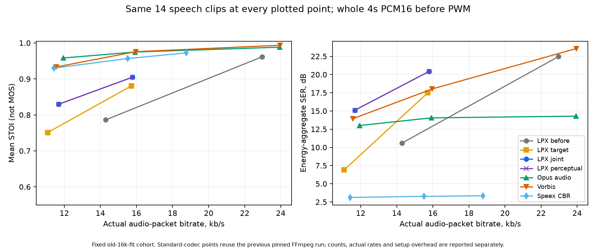

# LPX: лучшее качество при меньшем битрейте

25.10.2026. Выполнены четыре пункта [плана](../../LOWRATE_QUALITY_PLAN_RU.md).
Меняется офлайн-кодировщик; **все исходники и таблицы MCU-декодера
побайтно прежние**, как в baseline `a531ec14`. Синтаксис — существующие
L4HY v2 / opt-in compact24. Новых словарей, форматов и этапов распаковки нет.

При потолке audio **16 кбит/с**, на тех же 14 речевых
отрывках, где старый LPX помещался: средний STOI
**0.7861 → 0.9048**, SERΣ
**10.59 → 20.42 дБ**,
пиковая ошибка **11961 → 3969 PCM16**.
На всех 16 clean cases новый joint имеет fit 16/16
и STOI 0.9075. При 12 кбит/с fit
16/16, STOI 0.8361; прежний
ограниченный поиск не имел результатов на этом потолке для этих 16 речевых отрывков.
Это объективные метрики данного корпуса, не MOS и не слуховая оценка.

## Методика и границы

Тот же [корпус 27 × 4 с](corpus.json), моно PCM16 / 8 кГц, 108 с.
Восемь tuning-окон: `ru_pushkin`, `ru_square`, `en_sense`, `en_portrait`.
Восемь validation-окон: `ru_slutskaya`, `ru_russia`, `en_letter`,
`en_normcore`; эти четыре голоса не использовались для выбора параметров
этого этапа. Это разделение прежнего корпуса, не новый внешний корпус.
Параметры зафиксированы до validation и затем не подбирались по нему.
Остальные 11 случаев — quiet/noise, музыка и синтетические контроли.

Для каждого потока сохраняются все 32000 отсчётов. Уровень не нормализуется,
задержка и усиление не подгоняются. LPX сравнивается при известном сдвиге 0.
SER = 10 log10(Σx² / Σ(x−y)²); **SERΣ** в таблицах считается по суммарным
энергиям группы. Средний SER по файлам тоже сохранён в JSON.
RMSE и пиковая ошибка считаются после расширения до int64; процент пика
делится на 32768. Пик — худший отдельный отсчёт всей указанной группы.
STOI используется только для речи; он не равен проценту распознанных слов.
При тишине/нулевой ошибке SER имеет null и явный статус.

Потолок относится к audio-payload. Полный файл включает ещё 20 байт.
Одинаковый потолок не означает равенства достигнутого битрейта: фактическая
скорость дана отдельно. В WAV CLI `--max-bytes` считает **полный** файл,
`--audio-kbps` — audio-payload по точной длительности.
Исходные Ogg/MP3 уже могут содержать потери; общий PCM-эталон одинаков
для всех кодеков. Полночастотную музыку и аналоговый тракт эта работа
не оценивает.

## Четыре пункта на одном речевом наборе

Основная парная таблица — только общие 14 clean cases
при потолке 16 кбит/с, до PWM. Отсутствующий старый результат не считается
нулём качества и не добавляется к среднему.

| Этап | Общих cases | Факт. audio, кбит/с | SERΣ, дБ | RMSE, PCM16 | Макс. ошибка, PCM16 | STOI |
| --- | --- | --- | --- | --- | --- | --- |
| Прежний LPX | 14 | 14.286 | 10.59 | 562.60 | 11961 | 0.7861 |
| 1: реальные биты | 14 | 14.217 | 10.95 | 539.76 | 9453 | 0.7902 |
| 2: целевой бюджет + LSF | 14 | 15.719 | 17.49 | 254.23 | 9306 | 0.8807 |
| 3: совместный поиск | 14 | 15.783 | 20.42 | 181.56 | 3969 | 0.9048 |
| 4: взвешенная ошибка | 14 | 15.783 | 20.42 | 181.56 | 3969 | 0.9048 |


1. Реальные биты: стоимость выбранных direct/Rice/pitch кодов и scale/header
   проверяется против фактически записанных v2-битов. Это не исчерпывающий
   минимум среди всех lag/gain. Первый отдельный пилот с плотным спектром
   не достиг 16 кбит/с: LSF сами занимали около 4 кбит/с.
2. Целевой бюджет: seed может быть выше лимита; старое качество такого seed
   не становится недостижимым обязательным floor. Все наблюдения сохраняются,
   размер по lambda не считается монотонным. Средние LSF по двум/четырём
   кадрам передаются через существующий repeat tag, с Q12-аудитом полюсов.
   Это офлайн-анализ с look-ahead до 80 мс, не новый режим MCU.
3. Совместный поиск: beam4 через 40 отсчётов, соседние width/scale,
   рекурсивный pitch и уже существующие sparse-поправки до 10 импульсов.
   Исходный допустимый вариант сохраняется; waveform-отбор не ухудшает
   его полные SSE и STOI.
4. Перцептуальный поиск: W(z)=A(z/0.9)/A(z/0.6) применяется к ошибке
   только на ПК. Равные длины кодовых слов, полный native STOI gate,
   предел SSE до −3 дБ SER и предел пика +10% либо +256 PCM16 (большее).
   Поток изменился в 4 из 54 бюджетных точек.
   Это явный opt-in; waveform joint остаётся основным новым профилем.

Первые пилоты сохранены отдельно и не подменяются финальной матрицей:
[step1.json](step1.json), [step2-pilot.json](step2-pilot.json),
[step3-pilot.json](step3-pilot.json). У stage2 встречались очень низкие STOI
на части 12-кбитных tuning-вариантов; последующий joint и rollback
измеряются отдельно, не скрывая неудачных промежуточных решений.

## Все речевые случаи и проверка разделения

| Потолок, кбит/с | Этап | Fit | Факт. audio, кбит/с | SERΣ, дБ | Макс. ошибка | STOI |
| --- | --- | --- | --- | --- | --- | --- |
| 12 | Прежний LPX | 0/16 | — | — | — | — |
| 12 | 1: реальные биты | 0/16 | — | — | — | — |
| 12 | 2: целевой бюджет + LSF | 16/16 | 11.130 | 7.57 | 12861 | 0.7675 |
| 12 | 3: совместный поиск | 16/16 | 11.650 | 15.20 | 7345 | 0.8361 |
| 12 | 4: взвешенная ошибка | 16/16 | 11.650 | 15.20 | 7345 | 0.8361 |
| 16 | Прежний LPX | 14/16 | 14.286 | 10.59 | 11961 | 0.7861 |
| 16 | 1: реальные биты | 15/16 | 14.249 | 11.20 | 9453 | 0.8002 |
| 16 | 2: целевой бюджет + LSF | 16/16 | 15.592 | 17.57 | 9306 | 0.8864 |
| 16 | 3: совместный поиск | 16/16 | 15.648 | 19.92 | 5759 | 0.9075 |
| 16 | 4: взвешенная ошибка | 16/16 | 15.648 | 19.92 | 5759 | 0.9075 |


Нельзя непосредственно приписывать разницу среднего по старым 14 и новым
16 отрывкам только алгоритму. Для такой оценки выше использована общая
парная группа. Новые fit на ранее отсутствовавших случаях показаны отдельно.

| Набор | Потолок | Joint fit | Общих со старым | Старый STOI, общие | Joint STOI, общие | Joint STOI, все |
| --- | --- | --- | --- | --- | --- | --- |
| tuning | 12 | 8/8 | 0 | — | — | 0.7974 |
| tuning | 16 | 8/8 | 8 | 0.7430 | 0.8867 | 0.8867 |
| validation | 12 | 8/8 | 0 | — | — | 0.8749 |
| validation | 16 | 8/8 | 6 | 0.8436 | 0.9290 | 0.9284 |




### Более низкий битрейт относительно старого 16-кбитного варианта

Те же 14 отрывков, старый потолок 16 против
нового 12 кбит/с. Фактический audio-битрейт уменьшился на
18.28%; это отдельная парная
проверка именно меньшего битрейта, а не сравнение разных наборов.

| Вариант | Общих cases | Факт. audio, кбит/с | SERΣ, дБ | Макс. ошибка | STOI |
| --- | --- | --- | --- | --- | --- |
| Прежний LPX, потолок16 | 14 | 14.286 | 10.59 | 11961 | 0.7861 |
| Новый joint, потолок12 | 14 | 11.675 | 15.10 | 7345 | 0.8294 |


## Стандартные кодеки при тех же потолках

Ниже — все 16 clean cases. Стандартные результаты повторно используются
из [предыдущего зафиксированного FFmpeg-прогона](../q0-standards-2026-10-25/README.md)
на тех же эталонных hashes и потолках. Нового подбора стандартных кодеров
по результатам LPX не выполнялось. Их прежняя целочисленная компенсация
задержки, 80-мс flush-хвост с оплатой байтов и отдельный setup/Ogg overhead
сохраняются. Speex CBR — наибольшая нативная точка под лимитом.

| Потолок | Кодек | Cases | Факт. audio, кбит/с | SERΣ, дБ | Макс. ошибка | STOI |
| --- | --- | --- | --- | --- | --- | --- |
| 12 | 3: совместный поиск | 16 | 11.650 | 15.20 | 7345 | 0.8361 |
| 12 | 4: взвешенная ошибка | 16 | 11.650 | 15.20 | 7345 | 0.8361 |
| 12 | Opus audio | 16 | 11.943 | 13.24 | 8849 | 0.9586 |
| 12 | Opus VoIP | 16 | 11.944 | 7.45 | 10817 | 0.9594 |
| 12 | Vorbis | 16 | 11.612 | 13.89 | 9262 | 0.9361 |
| 12 | Speex ABR | 16 | 11.967 | 3.26 | 15357 | 0.9156 |
| 12 | Speex CBR ≤ cap | 16 | 11.424 | 3.08 | 23695 | 0.9314 |
| 16 | 3: совместный поиск | 16 | 15.648 | 19.92 | 5759 | 0.9075 |
| 16 | 4: взвешенная ошибка | 16 | 15.648 | 19.92 | 5759 | 0.9075 |
| 16 | Opus audio | 16 | 15.914 | 14.45 | 6346 | 0.9751 |
| 16 | Opus VoIP | 16 | 15.920 | 7.65 | 8279 | 0.9753 |
| 16 | Vorbis | 16 | 15.959 | 17.89 | 7150 | 0.9763 |
| 16 | Speex ABR | 16 | 15.905 | 3.33 | 14759 | 0.9380 |
| 16 | Speex CBR ≤ cap | 16 | 15.504 | 3.22 | 15736 | 0.9575 |


Больший SER означает лучшее совпадение формы волны, а не автоматически
более естественную речь. Улучшение LPX не доказывает превосходство над
Opus/Vorbis/Speex по слуху; фактические скорости и STOI нужно читать вместе.
Не заявляется равенство качеству прежних 24 кбит/с или полный оптимум поиска.

## Quiet, noise, музыка и общий PWM

| Группа | Потолок | Этап | Cases | SERΣ, дБ | Макс. ошибка | PCM STOI | PWM STOI |
| --- | --- | --- | --- | --- | --- | --- | --- |
| quiet | 12 | Прежний LPX | 0 | — | — | — | — |
| quiet | 12 | 3: совместный поиск | 2 | 14.38 | 107 | 0.7072 | 0.3535 |
| quiet | 12 | 4: взвешенная ошибка | 2 | 14.38 | 107 | 0.7072 | 0.3535 |
| quiet | 16 | Прежний LPX | 2 | 14.97 | 123 | 0.7784 | 0.3076 |
| quiet | 16 | 3: совместный поиск | 2 | 15.74 | 103 | 0.7892 | 0.3138 |
| quiet | 16 | 4: взвешенная ошибка | 2 | 15.74 | 103 | 0.7892 | 0.3138 |
| noise15 | 12 | Прежний LPX | 0 | — | — | — | — |
| noise15 | 12 | 3: совместный поиск | 2 | 10.43 | 4499 | 0.6904 | 0.6861 |
| noise15 | 12 | 4: взвешенная ошибка | 2 | 10.43 | 4499 | 0.6904 | 0.6861 |
| noise15 | 16 | Прежний LPX | 1 | 8.30 | 5456 | 0.7052 | 0.6970 |
| noise15 | 16 | 3: совместный поиск | 2 | 12.52 | 4177 | 0.8212 | 0.8136 |
| noise15 | 16 | 4: взвешенная ошибка | 2 | 12.52 | 4177 | 0.8212 | 0.8136 |
| acoustic_music | 12 | Прежний LPX | 0 | — | — | — | — |
| acoustic_music | 12 | 3: совместный поиск | 3 | 14.68 | 1285 | — | — |
| acoustic_music | 12 | 4: взвешенная ошибка | 3 | 14.68 | 1285 | — | — |
| acoustic_music | 16 | Прежний LPX | 3 | 12.52 | 1724 | — | — |
| acoustic_music | 16 | 3: совместный поиск | 3 | 18.08 | 938 | — | — |
| acoustic_music | 16 | 4: взвешенная ошибка | 3 | 18.08 | 938 | — | — |
| synthetic | 12 | Прежний LPX | 3 | 11.14 | 2782 | — | — |
| synthetic | 12 | 3: совместный поиск | 4 | 19.86 | 1433 | — | — |
| synthetic | 12 | 4: взвешенная ошибка | 4 | 19.86 | 1433 | — | — |
| synthetic | 16 | Прежний LPX | 4 | 26.13 | 1361 | — | — |
| synthetic | 16 | 3: совместный поиск | 4 | 28.61 | 1361 | — | — |
| synthetic | 16 | 4: взвешенная ошибка | 4 | 28.60 | 1363 | — | — |


Noise15 сравнивается с самим зашумлённым эталоном, а не оценивается как
шумоподавление. Музыка — три узкополосных акустических отрывка; синтетика
выделена отдельно. Общая цифровая PWM8-модель gain130/round1 побайтно
совпадает с native LPX; SER/STOI до и после неё хранятся отдельно.
Она не моделирует аналоговый фильтр/усилитель. Для тихой речи даже эталон
без кодека теряет качество на этой 8-битной шкале: прежний reference PWM
floor STOI 0,3495. Эту потерю нельзя устранить одной перепаковкой.

## Цена распаковки и AVR

Все decoder source/header/table hashes сверены с baseline; новые вычисления
остались на ПК. Тем не менее новый поток с меняющимся спектром может быть
дороже старого flat-спектра. Простой прежний декодер не означает одинаковое
время на любых данных. Формат compact24 требует прежнего явного
`LPX4_V3_FEATURES=24`; C fallback и архитектурный opt-in ASM сохранены.

ATmega328P / AVR5, 16 МГц / 8 кГц, AVR-GCC 7.3.0 GNU ABI `-Os`,
ASM opt-in, queue512/prefill384/unroll9. Полный simavr ELF с active IRQ,
точным конечным PWM, нативной моделью и повторным расчётом ошибок:

| Этап | Точек | Underruns | Decode budget, % | Max160, cycles | Min queue | Max Flash, Б | Static SRAM, Б |
| --- | --- | --- | --- | --- | --- | --- | --- |
| 1: реальные биты | 28 | 0 | 58.06–73.10 | 307308 | 385 | 16542 | 1102 |
| 2: целевой бюджет + LSF | 54 | 0 | 58.06–82.22 | 312267 | 377 | 16704 | 1102 |
| 3: совместный поиск | 54 | 0 | 58.06–83.13 | 326044 | 377 | 16698 | 1102 |
| 4: взвешенная ошибка | 54 | 0 | 58.06–83.13 | 326044 | 377 | 16698 | 1102 |


Всего 190 успешных бюджетных точек /
111 уникальных ELF. Побайтно прежние потоки
используют сохранённые прежние измерения с теми же source/tool/settings;
новые потоки измерены заново. Непринятых точек:
0. Подробности: [avr.json](avr.json).

Mean decode-wall включает active IRQ и диагностические stores, но не всю
работу приложения/публикации в очередь; это не измерение CPU idle.
Проверяются также max160 и min queue. Самое тяжёлое итоговое joint/perceptual
кодирование `en_sense_a4_noise15` повторено непрерывно до восьми секунд
с сохранением состояния на стыке и точной повторной упаковкой. Это timing
workload, а не новый независимый эталон качества.

| Профиль 8 с | Mean cycles/отсчёт | Decode budget, % | Underruns | Min queue | Flash, Б | Static SRAM, Б |
| --- | --- | --- | --- | --- | --- | --- |
| normal | 1667.092 | 83.355 | 0 | 377 | 24304 | 1102 |
| extra_irq100 | 1766.943 | 88.347 | 0 | 375 | 24312 | 1102 |
| c_fallback | 3254.736 | 162.737 | 42693 | 0 | 23490 | 1102 |


C fallback проверяет функциональное совпадение; его underruns, если есть,
не скрываются и не означают real-time поддержку C. Дополнительные 100 циклов
на IRQ — измеренный стресс именно данного повтора. Компактная очередь 256
и произвольный бесконечный поток здесь не объявляются поддержанными.
Физической платы нет; всё измерено в симуляторе. [Данные стресса](stress.json).

## Использование и воспроизведение

Новый профиль вызывается явно; прежний WAV CLI сохранён:

```sh
cd Codecs/LPX/01_ACTIVE_Q0_CODEC
python tools/encode_lowrate.py input.wav build/voice --audio-kbps 16 --kind speech
python tools/encode_lowrate.py input.wav build/voice12 --audio-kbps 12 --kind speech
python tools/encode_lowrate.py input.wav build/weighted --max-bytes 8020 --stage perceptual
```

Один сегмент до 8 с / 64000 отсчётов; длинную запись предварительно делят
на самостоятельные сегменты. Старый допустимый результат WAV CLI входит
в rollback. Новый CLI отдельно проверен на настоящем validation WAV
и полным AVR ELF: [cli-smoke.json](cli-smoke.json). Это отдельная проверка
входного пути; основная матрица стартует с ранее проверенных seed-спектров.

Все 82 host-теста прошли за 50.261 с; дополнительно
выполнены корпусные native/model/PWM проверки и [итоговый аудит](consistency.json).
Декодер не менялся, поэтому прежние standalone decoder fuzz/release-матрицы
не выдаются за заново выполненные. Источники, версии и SHA-256:
[environment.json](environment.json), [corpus.json](corpus.json),
[measurements.json](measurements.json), [measurements.csv](measurements.csv),
[summary.json](summary.json), [host.json](host.json).

Локальный слепой набор: `build/lpx-lowrate/final/listening/index.html`.
Восемь отрывков на каждом из потолков 12/16, перемешанные A–G и эталон R,
до/после PWM, без нормализации. Ключ и attribution отдельны.
**Человеческие оценки не собраны.** Все WAV/оригиналы/ELF/кэши остаются
в ignored build; в Git сохраняются численные отчёты и исходники.

Из корня checkout, с зависимостями и native g++/FFmpeg в PATH:

```sh
python -m pip install -r Codecs/LPX/01_ACTIVE_Q0_CODEC/requirements-research.txt
python Codecs/LPX/01_ACTIVE_Q0_CODEC/tools/benchmark_lowrate.py BASELINE_ROOT CORPUS build/lpx-lowrate/benchmark build/lpx-lowrate/benchmark.json
python Codecs/LPX/01_ACTIVE_Q0_CODEC/tools/validate_lowrate_avr.py CORPUS build/lpx-lowrate/benchmark build/lpx-lowrate/avr BASELINE_AVR_JSON --avr-bin AVR_BIN --sim-runner SIM_PROFILE --sim-lib-dir SIM_LIB --wsl Ubuntu
python Codecs/LPX/01_ACTIVE_Q0_CODEC/tools/summarize_lowrate.py build/lpx-lowrate/benchmark.json --corpus CORPUS --baseline-root BASELINE_ROOT --output build/lpx-lowrate/final --avr build/lpx-lowrate/avr/verification.json
python Codecs/LPX/01_ACTIVE_Q0_CODEC/tools/audit_lowrate.py build/lpx-lowrate/final/measurements.json build/lpx-lowrate/avr/verification.json CORPUS BASELINE_ROOT build/lpx-lowrate/final/consistency.json
python Codecs/LPX/01_ACTIVE_Q0_CODEC/tools/plot_lowrate.py build/lpx-lowrate/final/measurements.json BASELINE_MEASUREMENTS_JSON build/lpx-lowrate/final
python Codecs/LPX/01_ACTIVE_Q0_CODEC/tools/stress_lowrate.py build/lpx-lowrate/benchmark build/lpx-lowrate/avr/verification.json build/lpx-lowrate/stress --avr-bin AVR_BIN --sim-runner SIM_PROFILE --sim-lib-dir SIM_LIB --wsl Ubuntu
python -m unittest discover -s Codecs/LPX/01_ACTIVE_Q0_CODEC/tests -p 'test_*.py'
```

`BASELINE_ROOT` — checkout с предыдущими verified pools и результатами;
`CORPUS` — его ignored четырёхсекундный корпус, описанный corpus.json.
Источники и рецепты подготовки сохранены в предыдущем исследовании.
Разрешены непересекающиеся `--shard N --shards K`; итоговый summarize
принимает все части. В данном прогоне три процесса затем перераспределены
на шесть с сохранением проверяемых кэшей. Время отдельных candidates
наблюдалось при разной параллельной нагрузке; case wall time может включать
возобновление из кэша и не является холодным временем кодирования.
`requirements-research.txt` добавляет Matplotlib для графиков к обычным
зависимостям кодировщика; MCU-библиотека Python-зависимостей не имеет.
