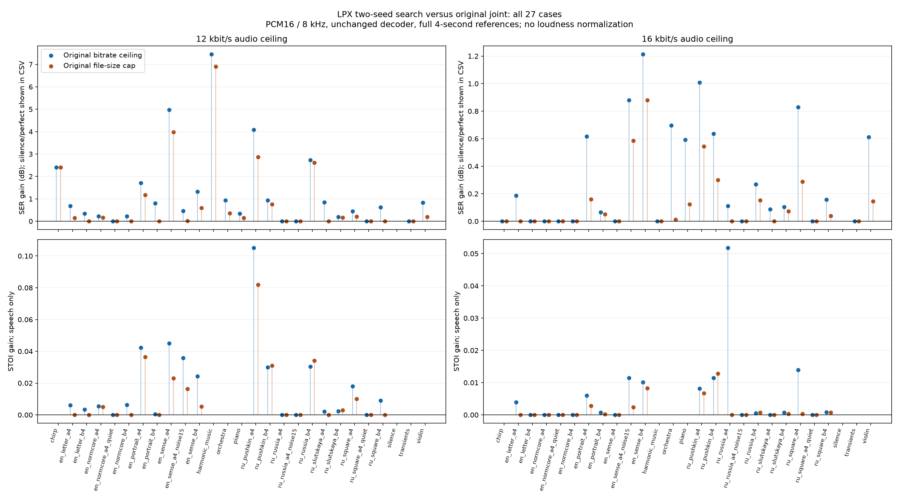

# LPX: два seed и уточнение бюджета на всём корпусе

Проверен весь прежний корпус: 27 × 4 секунды PCM16 mono / 8 кГц,
два потолка 12/16 кбит/с, два контроля — **108 выбранных точек**.
База — прежний `joint`, а не старый исходный WAV-кодировщик и не
`perceptual`. Все параметры сохранены до прогона в [протоколе](PROTOCOL.md).
Исходники декодера, таблицы, формат, состояние и C fallback не менялись.

Сравнивается весь пакет: два прежних seed 12/16 вместо одного выбранного
и десять уточнений границы на каждый seed. Раздельный вклад этих двух
изменений этим опытом не измеряется. Отбор использует полную SSE и STOI
речи, с прежним допустимым потоком для отката. Уменьшение средней ошибки
не гарантирует уменьшения пика или улучшения каждого слухового артефакта.
Отсутствие ухудшения SSE/STOI у выбранных результатов обеспечивается
отбором и откатом; не каждый сырой кандидат оказался лучше.

## Чистая речь: все 16 образцов

Одинаковый потолок audio-payload; фактические размеры могут различаться.
SERΣ — отношение суммарных энергий сигнала и ошибки. STOI — среднее по
образцам; это объективный показатель, не MOS и не доказательство
субъективного предпочтения. Усиление и задержка не подгонялись.

| Потолок | SERΣ до → после, дБ | STOI до → после | RMSE до → после | Пик до → после | Факт. кбит/с до → после |
|---|---:|---:|---:|---:|---:|
| 12 | 15.201 → 16.404 | 0.8361 → 0.8568 | 338.8 → 294.9 | 7345 → 6925 | 11.650 → 11.969 |
| 16 | 19.916 → 20.178 | 0.9075 → 0.9143 | 196.9 → 191.0 | 5759 → 5361 | 15.648 → 15.914 |

## Контроль без увеличения файла

Новый полный файл ограничен фактической длиной прежнего joint-файла
того же образца/режима. Он может оказаться меньше. Это контроль
«не больше прежнего», а не обязательное точное равенство байтов.

| Потолок | SERΣ до → после, дБ | STOI до → после | RMSE до → после | Пик до → после | Факт. кбит/с до → после |
|---|---:|---:|---:|---:|---:|
| 12 | 15.201 → 16.138 | 0.8361 → 0.8505 | 338.8 → 304.1 | 7345 → 6925 | 11.650 → 11.623 |
| 16 | 19.916 → 20.049 | 0.9075 → 0.9096 | 196.9 → 193.9 | 5759 → 5759 | 15.648 → 15.634 |

## Все образцы и перенос выигрыша

Число образцов с уменьшением полной PCM16 SSE; равенство означает
отсутствие прироста этой метрики. Для нулевого эталона и perfect SER
остаётся null с причиной. Отдельно исключён уже прослушанный stimulus
`ru_pushkin_a4`; это повторная проверка старого корпуса, не новый корпус.

| Группа | N | Режим | Меньше ошибки / равна / больше | SERΣ gain, дБ | Средний STOI gain |
|---|---:|---|---:|---:|---:|
| Все | 27 | 12, потолок | 21 / 6 / 0 | 1.230 | 0.0183 |
| Все | 27 | 12, размер | 16 / 11 / 0 | 1.004 | 0.0123 |
| Все | 27 | 16, потолок | 16 / 11 / 0 | 0.232 | 0.0060 |
| Все | 27 | 16, размер | 13 / 14 / 0 | 0.122 | 0.0018 |
| Без stimulus | 26 | 12, потолок | 20 / 6 / 0 | 0.996 | 0.0137 |
| Без stimulus | 26 | 12, размер | 15 / 11 / 0 | 0.832 | 0.0086 |
| Без stimulus | 26 | 16, потолок | 15 / 11 / 0 | 0.207 | 0.0059 |
| Без stimulus | 26 | 16, размер | 12 / 14 / 0 | 0.107 | 0.0015 |
| Чистая речь | 16 | 12, потолок | 15 / 1 / 0 | 1.203 | 0.0206 |
| Чистая речь | 16 | 12, размер | 10 / 6 / 0 | 0.937 | 0.0144 |
| Чистая речь | 16 | 16, потолок | 12 / 4 / 0 | 0.263 | 0.0068 |
| Чистая речь | 16 | 16, размер | 9 / 7 / 0 | 0.134 | 0.0021 |
| Речь без stimulus | 15 | 12, потолок | 14 / 1 / 0 | 0.827 | 0.0150 |
| Речь без stimulus | 15 | 12, размер | 9 / 6 / 0 | 0.655 | 0.0099 |
| Речь без stimulus | 15 | 16, потолок | 11 / 4 / 0 | 0.220 | 0.0067 |
| Речь без stimulus | 15 | 16, размер | 8 / 7 / 0 | 0.109 | 0.0018 |
| Tuning | 8 | 12, потолок | 8 / 0 / 0 | 2.041 | 0.0343 |
| Tuning | 8 | 12, размер | 6 / 2 / 0 | 1.474 | 0.0235 |
| Tuning | 8 | 16, потолок | 7 / 1 / 0 | 0.718 | 0.0064 |
| Tuning | 8 | 16, размер | 7 / 1 / 0 | 0.381 | 0.0040 |
| Validation | 8 | 12, потолок | 7 / 1 / 0 | 0.629 | 0.0070 |
| Validation | 8 | 12, размер | 4 / 4 / 0 | 0.548 | 0.0053 |
| Validation | 8 | 16, потолок | 5 / 3 / 0 | 0.112 | 0.0071 |
| Validation | 8 | 16, размер | 2 / 6 / 0 | 0.049 | 0.0001 |
| Тихая речь | 2 | 12, потолок | 0 / 2 / 0 | 0.000 | 0.0000 |
| Тихая речь | 2 | 12, размер | 0 / 2 / 0 | 0.000 | 0.0000 |
| Тихая речь | 2 | 16, потолок | 0 / 2 / 0 | 0.000 | 0.0000 |
| Тихая речь | 2 | 16, размер | 0 / 2 / 0 | 0.000 | 0.0000 |
| Речь + шум | 2 | 12, потолок | 1 / 1 / 0 | 0.082 | 0.0180 |
| Речь + шум | 2 | 12, размер | 1 / 1 / 0 | 0.003 | 0.0082 |
| Речь + шум | 2 | 16, потолок | 1 / 1 / 0 | 0.169 | 0.0057 |
| Речь + шум | 2 | 16, размер | 1 / 1 / 0 | 0.115 | 0.0012 |
| Музыка | 3 | 12, потолок | 3 / 0 / 0 | 0.784 | — |
| Музыка | 3 | 12, размер | 3 / 0 / 0 | 0.214 | — |
| Музыка | 3 | 16, потолок | 3 / 0 / 0 | 0.623 | — |
| Музыка | 3 | 16, размер | 3 / 0 / 0 | 0.122 | — |
| Синтетика | 4 | 12, потолок | 2 / 2 / 0 | 5.376 | — |
| Синтетика | 4 | 12, размер | 2 / 2 / 0 | 5.124 | — |
| Синтетика | 4 | 16, потолок | 0 / 4 / 0 | 0.000 | — |
| Синтетика | 4 | 16, размер | 0 / 4 / 0 | 0.000 | — |

## Каждый из 27 образцов

Прирост SER относительно прежнего joint, дБ; «размер» — без увеличения
полного файла. Значения округлены, полная точность сохранена в CSV.

| Образец | 12, потолок | 12, размер | 16, потолок | 16, размер |
|---|---:|---:|---:|---:|
| `chirp` | 2.406 | 2.406 | 0.000 | 0.000 |
| `en_letter_a4` | 0.689 | 0.147 | 0.186 | 0.000 |
| `en_letter_b4` | 0.337 | 0.000 | 0.000 | 0.000 |
| `en_normcore_a4` | 0.230 | 0.171 | 0.000 | 0.000 |
| `en_normcore_a4_quiet` | 0.000 | 0.000 | 0.000 | 0.000 |
| `en_normcore_b4` | 0.229 | 0.000 | 0.000 | 0.000 |
| `en_portrait_a4` | 1.714 | 1.171 | 0.615 | 0.159 |
| `en_portrait_b4` | 0.804 | 0.000 | 0.066 | 0.051 |
| `en_sense_a4` | 4.982 | 3.982 | 0.000 | 0.000 |
| `en_sense_a4_noise15` | 0.467 | 0.014 | 0.881 | 0.585 |
| `en_sense_b4` | 1.326 | 0.590 | 1.213 | 0.879 |
| `harmonic_music` | 7.453 | 6.910 | 0.000 | 0.000 |
| `orchestra` | 0.930 | 0.354 | 0.696 | 0.012 |
| `piano` | 0.344 | 0.143 | 0.591 | 0.123 |
| `ru_pushkin_a4` | 4.078 | 2.866 | 1.007 | 0.545 |
| `ru_pushkin_b4` | 0.943 | 0.758 | 0.635 | 0.300 |
| `ru_russia_a4` | 0.000 | 0.000 | 0.113 | 0.000 |
| `ru_russia_a4_noise15` | 0.000 | 0.000 | 0.000 | 0.000 |
| `ru_russia_b4` | 2.731 | 2.622 | 0.268 | 0.152 |
| `ru_slutskaya_a4` | 0.846 | 0.000 | 0.088 | 0.000 |
| `ru_slutskaya_b4` | 0.191 | 0.159 | 0.104 | 0.074 |
| `ru_square_a4` | 0.440 | 0.217 | 0.829 | 0.288 |
| `ru_square_a4_quiet` | 0.000 | 0.000 | 0.000 | 0.000 |
| `ru_square_b4` | 0.619 | 0.000 | 0.158 | 0.039 |
| `silence` | — | — | — | — |
| `transients` | 0.000 | 0.000 | 0.000 | 0.000 |
| `violin` | 0.833 | 0.196 | 0.613 | 0.146 |

## Пики, откаты и PWM

Защита SSE/STOI относится к PCM16. Пик не входит в этот фильтр и
показывается отдельно. Общий цифровой PWM8 также измерен отдельно:
его квантование может изменить малые выигрыши и STOI.

| Режим | Пик PCM16 вырос | Откат к прежним байтам | Сырый лучший отклонён по STOI | PWM: ошибка выросла / STOI снизился |
|---|---:|---:|---:|---:|
| 12, потолок | 2 | 6 | 0 | 0 / 2 |
| 12, размер | 5 | 11 | 4 | 1 / 2 |
| 16, потолок | 5 | 11 | 4 | 1 / 3 |
| 16, размер | 1 | 14 | 3 | 1 / 2 |

Наибольшее увеличение пика PCM16: +581 у `ru_slutskaya_a4`, 16, `enhanced`. Наибольшее снижение STOI после PWM: -0.0109 у `en_portrait_a4`, 12, `enhanced`. Эти случаи не скрываются за улучшением средней PCM16 ошибки.

Точные имена и показатели каждого случая: [CSV](measurements.csv), [summary](summary.json), [полные наблюдения поиска](measurements.json).

Любое строгое уменьшение SSE считается приростом в таблице выше. Чтобы отделить малые изменения, ниже — число случаев с приростом SER ≥0,1 / ≥0,5 дБ и медиана по конечным SER.

| Все 27 | SER ≥0,1 / ≥0,5 дБ | Медиана gain, дБ |
|---|---:|---:|
| 12, потолок | 21 / 14 | 0.654 |
| 12, размер | 15 / 8 | 0.153 |
| 16, потолок | 14 / 9 | 0.108 |
| 16, размер | 9 / 3 | 0.006 |

## Распаковка AVR

ATmega328P / AVR5, 16 МГц / 8 кГц, GNU AVR GCC7.3.0 `-Os`,
ASM только с явным opt-in, v3 mask24, queue512/prefill384/unroll9.
Полный ELF, активный audio IRQ, сверка всех PWM-байтов и отсутствие
пропусков проверяются для каждого выбранного потока. Средний decode
wall budget включает ISR и инструментирование; это не измерение
процента простоя физической платы и не бесконечная гарантия real-time.

108 точек / 88 уникальных ELF; 0 underruns, 0 непринятых точек. Средний бюджет 58.06–78.23%, максимум Flash 16706 байтов, static SRAM 1102. Среднее изменение нагрузки против старого joint 0.49 п.п., максимальное увеличение 8.67 п.п.

| Режим | Decode budget min–max | Средний прирост, п.п. |
|---|---:|---:|
| 12, потолок | 58.06–76.89% | 1.01 |
| 12, размер | 58.06–76.90% | 0.56 |
| 16, потолок | 58.06–78.23% | 0.15 |
| 16, размер | 58.06–78.23% | 0.23 |

Восьмисекундный непрерывный повтор самого тяжёлого принятого потока: `en_sense_a4`, 16, `enhanced`. Это timing workload с продолжающимся состоянием, не новый независимый эталон качества.

| Профиль повтора | Decode cycles/sample | Бюджет | Underruns |
|---|---:|---:|---:|
| normal | 1569.669 | 78.48% | 0 |
| extra_irq100 | 1633.230 | 81.66% | 0 |
| c_fallback | 3175.445 | 158.77% | 40157 |

Портативный C fallback остаётся явно выбираемым. Его функциональная
побайтовая точность и способность выдерживать реальное время — разные
проверки. Все результаты здесь получены в simavr1.6; физической платы нет.

## Воспроизводимость и цена поиска

1372 новых joint-оценок, 892 проверенных обращений к кэшу; сумма времени cases 5945.3 с. Пять непересекающихся процессов работают одновременно: это не последовательное wall time и не холодное время самостоятельного WAV encoder. Старые seed генерировались раньше и в эту цену не включены.

Стенд: `tools/benchmark_multiseed.py`, численный аудит и сводки:
`tools/summarize_multiseed.py`, полные ELF: `tools/validate_lowrate_avr.py
--stages enhanced size_matched`, длинный тест: `tools/stress_lowrate.py
--stages enhanced size_matched`. Все инструменты в `01_ACTIVE_Q0_CODEC`.
Запускаются из task checkout, с прежним корпусом и выбранными joint-seed.
Файлы WAV/LPX/ELF/cache остаются в ignored `build/lpx-multiseed/`.

[Независимый численный аудит](consistency.json), [AVR](avr.json),
[длинный тест](stress.json), [аудит длинного теста](stress-audit.json), [host-тесты](host.json),
[корпус/лицензии/исходные хеши](corpus.json), [окружение и исходники](environment.json).
Прежняя матрица остаётся замороженной; новый default encoder этим
сравнением не включается. Есть объективный замер всей матрицы и одно
предыдущее неформальное замечание слушателя; слепых человеческих оценок нет.
