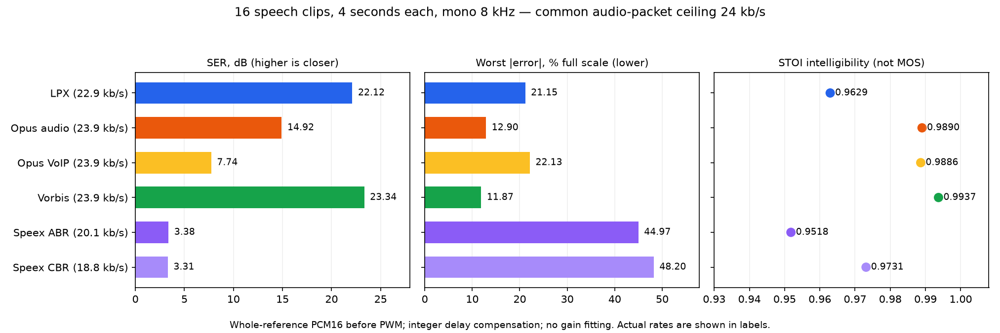
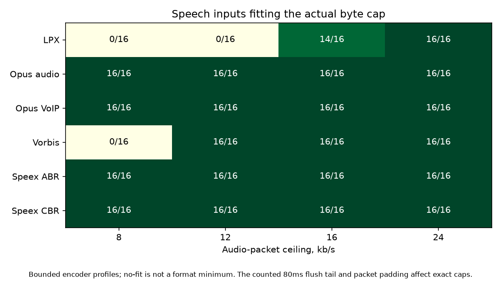

# LPX Q0 и стандартные кодеки: SER, максимальная ошибка и AVR

25.10.2026. Новые измерения на **27 отрывках по 4 секунды** (108 с),
моно PCM16 / 8 кГц. LPX сравнивается с libopus, libvorbis и libspeex через
FFmpeg 8.1.1. Проверены четыре потолка размера, тихая и зашумлённая речь,
реальная музыка, переходные сигналы, общий цифровой PWM и полный AVR ELF.
Арифметическое ядро LPX не менялось; baseline — `f1225f13`.

На 16 чистых речевых отрывках при потолке audio **24 кбит/с** LPX получил
SERΣ **22,12 дБ**, максимальную ошибку **6932 PCM16 / 21,15% FS** и STOI
**0,9629**. Vorbis в выбранном профиле лучше по всем трём показателям.
У Opus audio ниже SERΣ, но меньше пиковая ошибка и выше STOI. Speex CBR
тоже выше по STOI, хотя его совпадение формы волны хуже. Из этих чисел
не следует субъективное превосходство LPX над стандартными кодеками.

## Метрика и общие условия

Для эталона `x` и восстановленного сигнала `y` ошибка `e = y − x`:

```text
SER = 10 log10(sum(x²) / sum(e²))
RMSE = sqrt(sum(e²) / N)
peak = max(abs(e))
peak_percent_FS = peak × 100 / 32768
```

В таблицах **SERΣ** считается по суммарным энергиям всей указанной группы;
отдельно приведено среднее SER отдельных файлов. Громкие отрывки дают
больше веса SERΣ, поэтому эти два способа усреднения отличаются.
STOI усредняется по речевым файлам; это объективный индекс, а не MOS
и не процент распознанных слов. Для музыки STOI не вычисляется.

Разность расширяется до int64 перед вычитанием: допустимый максимум ошибки
PCM16 равен 65535. Позиция пика — первый максимальный отсчёт, индекс с нуля
на шкале эталона. Для тишины/точного совпадения SER хранится как `null`
с причиной `zero_reference`/`perfect`; вымышленные конечные числа не вводятся.

Основная таблица использует **все 32000 отсчётов** каждого эталона, до PWM,
после целочисленного выравнивания задержки стандартных кодеков корреляцией
в пределах 0–60 мс. LPX использует известную задержку 0. Выравнивание
сохраняет весь эталон, включая края. Масштаб/усиление не подгоняются.
Невыровненные PCM16 и выровненный общий PWM сохранены отдельными фазами.

Все кодеки получают один и тот же узкополосный эталон. Исходные публичные
Ogg/MP3 уже могли содержать потери: здесь измеряется дополнительная ошибка
относительно одинакового подготовленного PCM, а не студийного оригинала.
Это не сравнение fullband-кодирования и не статистика на новых говорящих.

## Чистая речь, потолок audio 24 кбит/с

16 отрывков, восемь ранее атрибутированных RU/EN голосов. Окна начинаются
на две секунды позже старых двухсекундных LPX-окон и с ними не пересекаются.
У всех шести профилей есть результат на каждом из этих 16 отрывков.

| Кодек | Факт. audio, кбит/с | SERΣ, дБ | Средний SER, дБ | RMSE, PCM16 | Макс. \|e\|, PCM16 | Макс. \|e\|, % FS | Средний STOI |
| --- | --- | --- | --- | --- | --- | --- | --- |
| LPX Q0 | 22.924 | 22.12 | 25.11 | 152.77 | 6932 | 21.15 | 0.9629 |
| Opus audio | 23.940 | 14.92 | 18.18 | 349.93 | 4226 | 12.90 | 0.9890 |
| Opus VoIP | 23.927 | 7.74 | 8.55 | 800.17 | 7251 | 22.13 | 0.9886 |
| Vorbis | 23.947 | 23.34 | 24.47 | 132.78 | 3890 | 11.87 | 0.9937 |
| Speex ABR | 20.088 | 3.38 | 3.88 | 1321.68 | 14737 | 44.97 | 0.9518 |
| Speex CBR ≤ cap | 18.768 | 3.31 | 3.82 | 1332.15 | 15795 | 48.20 | 0.9731 |


«Макс. |e|» — один худший отсчёт **во всей группе**, не среднее пиков.
Средние/медианные ошибки каждого отрывка доступны в JSON/CSV.

| Кодек | Худший речевой case | e = y − x | Индекс (с 0) | Время эталона, с |
| --- | --- | --- | --- | --- |
| LPX Q0 | ru_russia_b4 | 6932 | 18636 | 2.329500 |
| Opus audio | ru_slutskaya_b4 | 4226 | 31615 | 3.951875 |
| Opus VoIP | ru_slutskaya_b4 | -7251 | 30986 | 3.873250 |
| Vorbis | ru_slutskaya_b4 | 3890 | 13317 | 1.664625 |
| Speex ABR | ru_russia_b4 | -14737 | 20168 | 2.521000 |
| Speex CBR ≤ cap | ru_russia_b4 | -15795 | 20168 | 2.521000 |


Для LPX это отсчёт 18636 (`ru_russia_b4`), на 2,3295 с эталона.
Худший пик LPX при 24 кбит/с по всем 27 cases совпал с этим речевым случаем.
На остальных потолках максимумы другие: например, на 14 общих речевых
cases при 16 кбит/с пик LPX достигает 11961.



## Бюджеты и недобранный битрейт

Audio-байты отделены от setup/comments/Ogg pages. Один потолок не означает
равенства фактических битрейтов: они приведены в таблицах. У LPX 20 байт
обязательного заголовка считаются отдельно; Vorbis setup также учитывается
отдельно и включается в сравнение полного файла ниже. Стандартным кодекам
добавлено 80 мс нулевого хвоста для сохранения конца эталона после задержки;
его пакеты входят в размер. Частота кадров и округление байтов особенно
заметны у Speex CBR.

Число успешно закодированных речевых cases при точном потолке:

| Профиль | 8 кбит/с | 12 кбит/с | 16 кбит/с | 24 кбит/с |
| --- | --- | --- | --- | --- |
| LPX Q0 | 0/16 | 0/16 | 14/16 | 16/16 |
| Opus audio | 16/16 | 16/16 | 16/16 | 16/16 |
| Opus VoIP | 16/16 | 16/16 | 16/16 | 16/16 |
| Vorbis | 0/16 | 16/16 | 16/16 | 16/16 |
| Speex ABR | 16/16 | 16/16 | 16/16 | 16/16 |
| Speex CBR ≤ cap | 16/16 | 16/16 | 16/16 | 16/16 |


LPX no-fit означает отсутствие кандидата в **зафиксированном конечном
поиске кодировщика**, а не невозможность формата уложиться в этот размер
с любым качеством. Аналогично Vorbis 0/16 при 8 кбит/с относится к проверенному
bitrate-control профилю и подсчёту пакетов с хвостом. Нативный Vorbis `-q`
в этой работе не исследовался; глобального оптимума кодеров не заявляем.



Чтобы не сравнивать разные наборы при 16 кбит/с, следующая таблица содержит
**одни и те же 14** речевых отрывков, где LPX уложился в лимит:

| Кодек | Общих cases | Факт. audio, кбит/с | SERΣ, дБ | Макс. \|e\| | STOI |
| --- | --- | --- | --- | --- | --- |
| LPX Q0 | 14 | 14.286 | 10.59 | 11961 | 0.7861 |
| Opus audio | 14 | 15.917 | 14.05 | 6346 | 0.9748 |
| Opus VoIP | 14 | 15.922 | 7.44 | 8279 | 0.9753 |
| Vorbis | 14 | 15.962 | 18.02 | 7150 | 0.9757 |
| Speex ABR | 14 | 15.950 | 3.37 | 14102 | 0.9351 |
| Speex CBR ≤ cap | 14 | 15.504 | 3.28 | 15736 | 0.9565 |


При 16 кбит/с LPX заметно теряет STOI относительно измеренных стандартных
профилей; результат 24 кбит/с нельзя переносить на низкие битрейты.

Speex дополнительно измерен в восьми настоящих CBR operating points.
`CBR ≤ cap` выбирает самый высокий из них, помещающийся в лимит, без выбора
по качеству. Номинальные 24,6 кбит/с дают 25,296 кбит/с фактических пакетов
и поэтому не проходят потолок 24 кбит/с.

| Номинал CBR, бит/с | Факт. audio, кбит/с | SERΣ, дБ | STOI |
| --- | --- | --- | --- |
| 2150 | 2.448 | -0.49 | 0.7233 |
| 3950 | 4.080 | 3.18 | 0.8182 |
| 5950 | 6.120 | 3.13 | 0.8581 |
| 8000 | 8.160 | 2.97 | 0.8901 |
| 11000 | 11.424 | 3.08 | 0.9314 |
| 15000 | 15.504 | 3.22 | 0.9575 |
| 18200 | 18.768 | 3.31 | 0.9731 |
| 24600 | 25.296 | 3.38 | 0.9806 |


## Одинаковый потолок полного файла

Для каждого из тех же 16 речевых cases стандартному кодеру задан потолок,
равный **полной длине LPX-файла** из 24-кбитного ряда. Каждый отдельный
файл проверен по своему потолку; средние размеры ниже не являются общим
фиксированным лимитом. Speex CBR выбран по тому же полному размеру.

| Кодек | Средний полный файл, Б | Факт. audio, кбит/с | SERΣ, дБ | Макс. \|e\| | STOI |
| --- | --- | --- | --- | --- | --- |
| LPX Q0 | 11481.9 | 22.924 | 22.12 | 6932 | 0.9629 |
| Opus audio | 11406.9 | 21.892 | 14.34 | 5226 | 0.9857 |
| Opus VoIP | 11452.7 | 21.983 | 7.72 | 7580 | 0.9866 |
| Vorbis | 11453.8 | 17.140 | 18.61 | 5826 | 0.9804 |
| Speex ABR | 10479.1 | 19.930 | 3.38 | 14737 | 0.9517 |
| Speex CBR ≤ cap | 9898.0 | 18.768 | 3.31 | 15795 | 0.9731 |


Обязательный Vorbis setup занимает примерно 2,5–2,9 КБ и заметен на
отдельном четырёхсекундном файле. При потолке полного файла Vorbis получает
меньше audio-байтов, SERΣ становится ниже LPX, но STOI остаётся выше.
Это конкретный сценарий коротких самостоятельных файлов; для длинных
потоков или разделяемого setup накладные расходы будут другими.

## Музыка, тихая речь и шум

Три акустических отрывка: фортепиано, оркестр, скрипка. Вход по-прежнему
моно 8 кГц; SER и пиковая ошибка оценивают форму волны, а не естественность.

| Кодек | Факт. audio, кбит/с | SERΣ, дБ | Средний SER, дБ | Макс. \|e\| |
| --- | --- | --- | --- | --- |
| LPX Q0 | 22.395 | 24.98 | 25.54 | 726 |
| Opus audio | 23.980 | 21.98 | 23.28 | 733 |
| Opus VoIP | 23.923 | 3.19 | 8.77 | 4471 |
| Vorbis | 23.934 | 26.81 | 27.42 | 355 |
| Speex ABR | 21.819 | 3.81 | 6.63 | 5091 |
| Speex CBR ≤ cap | 18.768 | 3.76 | 6.55 | 5397 |


Синтетические harmonic/chirp/transients/silence измерены отдельно от
реальной музыки. На них LPX при 24 кбит/с имеет SERΣ 34,86 дБ и пик 1361;
победа на этих четырёх тестах не доказывает качество на произвольной музыке.

Тихие варианты имеют −24 дБ относительно исходного окна. Для двух noise15
вариантов добавлен seeded white noise 15 дБ; эталон метрик — сам зашумлённый
сигнал. Этот тест не оценивает шумоподавление относительно чистой речи.

Общая PWM-модель точно повторяет цифровое преобразование LPX gain130/round1:

```python
q14 = (pcm_int64 + 1) // 2
u8 = clip(128 + ((q14 * 130 + 8192) >> 14), 0, 255)
pcm_pwm = (u8 - 128) * 256
```

Для LPX она проверена побайтно против native PWM; к стандартным кодекам
применён такой же выходной этап. Это модель общего 8-битного выхода,
а не измерение их AVR-портов или аналогового фильтра/усилителя.

| Группа | Тракт | PCM SERΣ, дБ | PCM STOI | PWM SERΣ, дБ | PWM STOI |
| --- | --- | --- | --- | --- | --- |
| clean | Эталон → PWM | — | — | 28.08 | 0.9089 |
| clean | LPX Q0 | 22.12 | 0.9629 | 21.14 | 0.8898 |
| clean | Opus audio | 14.92 | 0.9890 | 14.71 | 0.8992 |
| clean | Vorbis | 23.34 | 0.9937 | 21.98 | 0.9071 |
| clean | Speex CBR ≤ cap | 3.31 | 0.9731 | 3.22 | 0.8873 |
| quiet | Эталон → PWM | — | — | 4.06 | 0.3495 |
| quiet | LPX Q0 | 22.71 | 0.9160 | 4.02 | 0.3604 |
| quiet | Opus audio | 22.68 | 0.9909 | 4.03 | 0.3491 |
| quiet | Vorbis | 30.03 | 0.9963 | 4.05 | 0.3493 |
| quiet | Speex CBR ≤ cap | 6.10 | 0.9770 | 2.05 | 0.3644 |
| noise15 | Эталон → PWM | — | — | 27.05 | 0.9821 |
| noise15 | LPX Q0 | 16.48 | 0.9154 | 16.09 | 0.9025 |
| noise15 | Opus audio | 14.04 | 0.9766 | 13.80 | 0.9594 |
| noise15 | Vorbis | 20.70 | 0.9824 | 19.69 | 0.9674 |
| noise15 | Speex CBR ≤ cap | 2.21 | 0.9306 | 2.13 | 0.9169 |


Для тихих отрывков даже **эталон без кодека** после этого PWM имеет STOI
0,3495 и SERΣ 4,06 дБ. В этом режиме узкое место — выбранная 8-битная
выходная шкала и уровень сигнала. Улучшение кодировщика само по себе
не устранит её потери. Нормализация уровня в сравнение не вводилась.

## Проверка задержки и декодирования

Дополнительный эксперимент на 16 чистых речевых и трёх музыкальных cases:
корреляционный поиск с шагом 1/16 отсчёта в ±8 отсчётов около целого сдвига,
Kaiser8.6/polyphase, по 160 guard-отсчётов на краях, без подбора усиления.
Он отделён от основных полных четырёхсекундных метрик. Максимальное изменение
SER: LPX +0,153 дБ, Opus audio +0,048 дБ, Opus VoIP +2,537 дБ,
Speex ABR/CBR около +0,708 дБ; Vorbis практически не меняется.
Один дробный сдвиг не объясняет различия SER, но это не исключает иных
фильтровых/фазовых различий и не превращает SER в слуховой рейтинг.

На 19 Opus VoIP декодированиях проверены предупреждения FFmpeg о DTS:
явные `aresample=8000,asetpts=N/SR/TB` дали **побайтно тот же PCM**.
Повторно декодированные выровненные PCM всех 19 × 6 случаев совпали с
основными замерами. Данные: [alignment-diagnostic.json](alignment-diagnostic.json).

## AVR: весь поток с активными прерываниями

ATmega328P / AVR5, 16 МГц / 8 кГц, AVR-GCC 7.3.0, GNU ABI, `-Os`, явный
`LPX4_ENABLE_ASM=1`, `LPX4_V3_FEATURES=24`, queue512/prefill384/unroll9.
C fallback остаётся выбираемым; ASM и аппаратный Flash I/O не менялись.

Все **56 успешных LPX-точек / 50 уникальных потоков** проверены native
PCM16 против независимой модели, native PWM против общей модели и полным
simavr ELF. Каждый из 50 образов проиграл все 32000 отсчётов с точным PWM
и **0 underruns**. Среднее decode-wall потребляет 58,06–95,39% бюджета;
минимальная очередь до EOS по матрице — 249, максимальный полный Flash —
20672 Б. Источники/ELF/HEX и параметры зафиксированы в [avr.json](avr.json).

Самый тяжёлый новый case — `en_sense_a4`, 24 кбит/с:
1907,833 cycles/отсчёт, максимум 326681 cycles на 160 отсчётов при номинальном
бюджете 320000. Очередь компенсирует локальные всплески на этом отрывке.

Его LSF/excitation повторены дважды в **непрерывном восьмисекундном**
потоке с сохранением состояния на стыке и точной повторной упаковкой.
Это нагрузка для тайминга, а не новый независимый эталон качества.

| Профиль 8 с | Средние cycles/отсчёт | % бюджета decode | Min queue | Underruns | Max 160, cycles | Flash, Б | Static SRAM, Б |
| --- | --- | --- | --- | --- | --- | --- | --- |
| normal | 1909.258 | 95.463 | 111 | 0 | 327750 | 31900 | 1102 |
| compact | 1920.403 | 96.020 | 0 | 431 | 329181 | 31486 | 846 |
| load50 | 1961.283 | 98.064 | 0 | 1643 | 336735 | 31908 | 1102 |
| load100 | 2016.412 | 100.821 | 0 | 3498 | 346067 | 31908 | 1102 |


`normal`: queue512/prefill384/unroll9. `compact`: queue256/prefill160/unroll3.
`load50/100`: обычная очередь плюс 50/100 дополнительных циклов на audio IRQ.
Прогон включает active IRQ, диагностические stores и публикацию в очередь.
Процент в таблице относится к измеренным интервалам decode, а не ко всему
CPU idle приложения. Поэтому среднее ниже 100% само по себе не гарантирует
непрерывную выдачу: compact получил **431 underrun**, load50 — **1643**.

Новый тяжёлый поток опровергает обобщение прежних успешных compact-замеров
на все данные. Обычная очередь прошла эту матрицу и восьмисекундный повтор,
но бесконечный произвольный поток и дополнительная нагрузка приложения
этим не подтверждены. Платы нет; всё измерено в симуляторе.
Время декодирования Opus/Vorbis/Speex на AVR в этой работе не измерялось.
Подробности стресса: [headroom.json](headroom.json).

## Что сохранено и как повторить

- [PROTOCOL.md](PROTOCOL.md): границы сравнения и замороженные параметры.
- [measurements.csv](measurements.csv): 2916 строк, включая no-fit,
  все три фазы, четыре потолка, file match и восемь CBR точек.
- [measurements.json](measurements.json): метрики, фактические байты,
  команды кодирования/декодирования, попытки поиска и SHA-256.
- [summary.json](summary.json): все группы и парные сравнения на общих cases.
- [corpus.json](corpus.json): окна, рецепты, авторы, лицензии, URL, исходные
  и эталонные hashes; [music-sources.json](music-sources.json) — вход prepare.
- [environment.json](environment.json), [host.json](host.json),
  [consistency.json](consistency.json): версии/хеши, 67 успешных host-тестов,
  отдельная итоговая проверка полноты, потолков, PCM, метрик и AVR-образов.

Аудио, исходные медиа, ELF/HEX и поисковые кэши остаются в ignored `build/`.
Локальный анонимный набор: `build/lpx-standards/final/listening/index.html`.
В нём восемь cases, шесть перемешанных кодеков A–F и эталон R, каждый
до/после общего PWM, без нормализации. Attribution хранится отдельно;
ключ открывается после записи предпочтений. **Слуховых оценок пока нет.**

С установленными зависимостями и `g++`/FFmpeg в PATH, из корня checkout:

```sh
python Codecs/LPX/01_ACTIVE_Q0_CODEC/tools/benchmark_standards.py prepare EXTERNAL_SPEECH_CORPUS Codecs/LPX/research/q0-standards-2026-10-25/music-sources.json build/lpx-standards/corpus
python Codecs/LPX/01_ACTIVE_Q0_CODEC/tools/benchmark_standards.py run build/lpx-standards/corpus build/lpx-standards/results build/lpx-standards/benchmark.json
python Codecs/LPX/01_ACTIVE_Q0_CODEC/tools/summarize_standards.py build/lpx-standards/benchmark.json --corpus build/lpx-standards/corpus --results build/lpx-standards/results --output build/lpx-standards/final
python Codecs/LPX/01_ACTIVE_Q0_CODEC/tools/plot_standards.py build/lpx-standards/final/summary.json build/lpx-standards/final
python -m unittest discover -s Codecs/LPX/01_ACTIVE_Q0_CODEC/tests -p 'test_*.py'
```

`EXTERNAL_SPEECH_CORPUS` содержит прежние `corpus.json` и
`originals/<source-id>.ogg`; его source hashes обязаны совпасть с сохранённым
манифестом. Три музыкальных оригинала скачиваются по URL в
`music-sources.json` в указанные ignored local пути, проверяются по SHA-256.
Ничего из этих бинарных оригиналов в Git не сохраняется.

При необходимости `run --shard 0 --shards 2` и `--shard 1 --shards 2`
используют общий проверяемый кэш и отдельные JSON; summarize принимает оба.
Native C++ adapter этой Windows-среды описан в environment.json.
Для AVR требуются настоящий AVR toolchain и simavr runner:

```sh
python Codecs/LPX/01_ACTIVE_Q0_CODEC/tools/validate_standards_avr.py build/lpx-standards/corpus build/lpx-standards/results build/lpx-standards/avr --avr-bin AVR_BIN --sim-runner SIM_PROFILE --sim-lib-dir SIM_LIB --wsl Ubuntu
python Codecs/LPX/01_ACTIVE_Q0_CODEC/tools/standard_headroom.py build/lpx-standards/results build/lpx-standards/avr/verification.json build/lpx-standards/headroom --avr-bin AVR_BIN --sim-runner SIM_PROFILE --sim-lib-dir SIM_LIB --wsl Ubuntu
python Codecs/LPX/01_ACTIVE_Q0_CODEC/tools/diagnose_standard_alignment.py build/lpx-standards/final/measurements.json build/lpx-standards/corpus build/lpx-standards/results build/lpx-standards/final/alignment-diagnostic.json
```

LPX-поиск: legacy/regularized/flat, lambda
0/.001/.003/.01/.03/.1/1/10, сохранение STOI legacy baseline и минимум MSE
среди допустимых кандидатов; один unified round LSF80/beam128/header40/global8,
128 global states/beam4. Затем zero packing, scale-DP, exact excitation repack
выбранного кандидата, compact mask24, финальный cap gate и исходный rollback.
Это ограниченный поиск, не исчерпывающий перебор всех потоков.

Стандарты: Opus audio/VoIP complexity10/VBR/20ms, libvorbis bitrate control,
Speex complexity10/ABR и native CBR, VAD/DTX выключены, frames-per-packet1.
Поиск стандартного bitrate — максимум 16 попыток до попадания в 0,5%
недобора либо исчерпания диапазона. Недобор, неподдержанные настройки и
все попытки сохранены; часть профилей существенно не выбирает весь лимит.
На других версиях кодеров или иных параметрах результаты могут отличаться.
