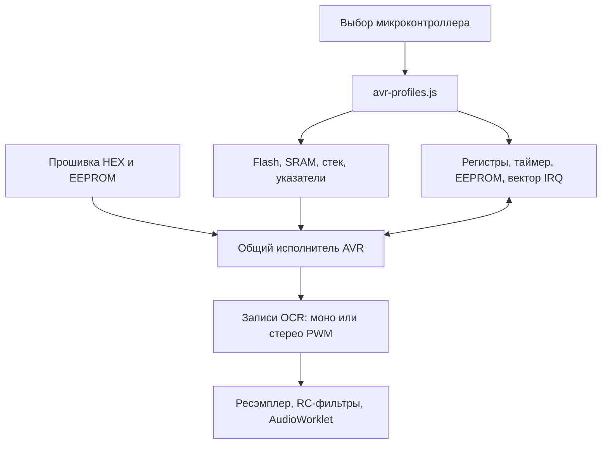

# Общий конфигурируемый эмулятор AVR

ATtiny13A и ATtiny88 используют общее ядро исполнения команд. Выбор микросхемы меняет профиль памяти и периферии. У JS и C/WASM свои реализации исполнения, которые проверяются друг против друга; отдельных копий процессора для каждой микросхемы больше нет.



## Что задаёт профиль

Все адреса профиля записаны в пространстве данных; для `IN/OUT` прибавляется `0x20`. Профили глубоко заморожены, поэтому один экземпляр не может изменить конфигурацию другого.

| Параметр | ATtiny13A | ATtiny88 |
|---|---|---|
| `target` | `attiny13a` | `attiny88` |
| Flash | 1024 Б | 8192 Б |
| SRAM | 64 Б, `0x60…0x9F` | 512 Б, `0x100…0x2FF` |
| EEPROM | 64 Б | 64 Б |
| Тактовая частота наших прошивок | 9,6 МГц | 8 МГц |
| Таймер музыкального выхода | Timer0, Fast PWM mode 3 | Timer1, Fast PWM mode 5 |
| OCR A / B, адреса данных | `0x56` / `0x49` | `0x88` / `0x8A` |
| Вектор overflow, адрес в словах | 3 | 11 |

Карты сверены с официальными [ATtiny13A DS40002307A](https://ww1.microchip.com/downloads/en/DeviceDoc/ATtiny13A-Data-Sheet-DS40002307A.pdf) и [ATtiny48/88, doc8008](https://ww1.microchip.com/downloads/en/DeviceDoc/doc8008.pdf). Синтез музыки выполняет сама прошивка, которую исполняет эмулятор.

## Использование

```js
import {AVRCore} from './lib/avr-core.js'; // C/WASM
// Для JS: import {AVRCore} from './lib/avr-reference.js';

const cpu = new AVRCore(flashBytes, eepromBytes, {
  target: 'attiny88',
  fastIdle: true,
  fastBlocks: true,
});
const right = cpu.nextDuty();
// Для стереопрошивки вместо nextDuty():
// const packed = cpu.nextStereoDuty(); // L в младшем, R в старшем байте
```

Без `target` выбирается ATtiny13A для совместимости со старыми инструментами. Неизвестная микросхема и превышение размера памяти завершаются ошибкой. `avr-attiny88.js` и `tools/avr-music-target-core.mjs` оставлены как короткие адаптеры для прежних импортов.

В ветке с транспилятором также доступны движки `transpiled` и `device` для
ATtiny13A. При выборе ATtiny88 используются общие JS/WASM-исполнители;
транспиляция и физическая периферия ATtiny88 пока не поддерживаются. Интерфейс
отключает эти два варианта и выбирает WASM, если до смены чипа был выбран один
из них. Импорт пакетов ATtiny13A доступен при выбранном ATtiny13A.

## Где хранится реализация

- `lib/avr-profiles.js` — единый источник адресов, размеров памяти, масок и векторов.
- `lib/avr-reference.js` — один JS-декодер и исполнитель для обоих профилей.
- `native/avr.c` — один C-декодер и исполнитель; `lib/avr-wasm.js` передаёт ему числовые поля того же профиля.
- `lib/avr-runtime.js` — общая обёртка состояния и ABI для обычного WASM,
  транспилятора и физического ATtiny13A; загрузчики передают готовый модуль.
  Исторические пакеты сохраняют собственную раскладку состояния. Ширина
  декодированных операндов определяется через ABI: 32 бита у общего
  музыкального ядра, 16 бит у физического ATtiny13A и прежних пакетов.
- `native/devices/attiny13a/avr-profile.inc` — инициализация фиксированного
  физического профиля по определениям Microchip, в том числе для прямых C-вызовов.
  Оба варианта собираются из `native/avr.c`; периферия и генератор WASM остаются
  отдельными модулями. Память физического ATtiny13A не расширяется до ATtiny88.
- `lib/renderer-js.js` и `lib/renderer.js` — выбирают профиль по `entry.device`; оба доступны для обоих чипов.
- `tools/avr-standalone.py` — собирает эти же JS-модули в автономные `avr_core.js` и HTML-плееры. Хеши всех входных модулей сохраняются в отчёте сборки с нормализацией LF.

WASM занимает фиксированные 128 КиБ памяти браузера на экземпляр. В эту память входят таблицы декодирования для максимального профиля, эмулируемая память и звуковые буферы. Импортов из хоста и увеличения памяти нет. Это расход памяти эмулятора на компьютере; размеры прошивок микроконтроллеров не изменились.

## Проверка и расширение

`tests/avr-profiles.test.mjs` проверяет независимые экземпляры, память, стек, инструкции, адреса OCR, IRQ и EEPROM. Сохранённый эталон `tests/fixtures/avr-profile-baseline.json` получен до объединения: PWM и полное состояние всех 18 образов сравниваются с ним в JS и WASM.

```text
node --test web-player/tests/*.test.mjs tools/avr-music-target-core.test.mjs tools/music-startup.test.mjs
node tools/audit-common-avr.mjs
```

Полный аудит исполняет каждую мелодию до повторного запуска, проверяет все музыкальные команды, состояния голосов, FIFO и временные бюджеты. Результат — `reports/common-avr-verification.json`.

Для новой микросхемы нужно добавить профиль, проверить его карту по официальной документации и тестами подтвердить геометрию памяти, регистры и прерывания. Если у неё другой тип периферии, потребуется реализация этого типа в JS и C. Копировать декодер команд для этого не нужно.

Текущие буферы WASM рассчитаны на Flash до 8192 Б и пространство данных до `0x2FF`. Для более крупного чипа потребуется увеличить эти границы и объём памяти в сборке WASM; неподходящий профиль не должен молча обрезать память.

Сохранён прежний объём модели: нужное прошивкам подмножество AVR, Timer0/Timer1, чтение EEPROM и защищённая стартовая последовательность отключения watchdog. ADC, запись EEPROM, работа включённого watchdog и электрические фронты PWM не моделируются; неподдерживаемые операции завершаются явной ошибкой. Физическая плата этой проверкой не заменяется.
