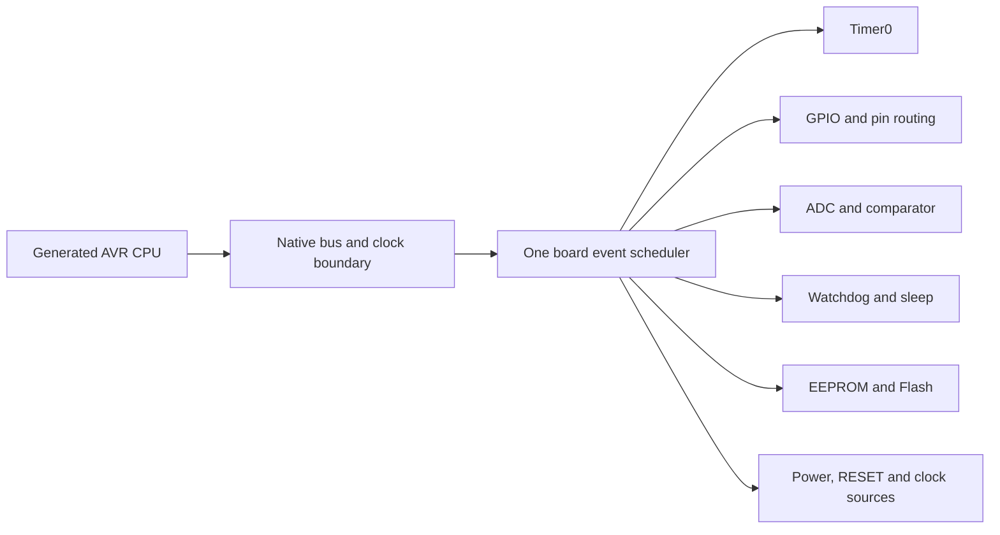

# Simplify the model while preserving device behavior

Requested direction, 2026-10-26. Simplification means fewer duplicated rules and
calculations while preserving the complete ATtiny13A observation contract. It
does not reduce the hardware coverage or close a checklist item by assumption.

## Existing foundation

The project already separates generated AVR instruction effects, the native
CPU/clock bridge, the board scheduler and device-owned peripheral modules.
`device.c` owns the shared timeline, event ordering and pin/interrupt routing.
Controllers own their register behavior and state machines. The emitter emits
real WASM instructions and calls native WASM bridges; it does not call JavaScript
for each instruction or hardware edge.

Preserve these file/module boundaries. The next simplification is a clearer
shared contract and less duplicate work at the boundaries, rather than moving
all hardware into one general interpreter.

## Common controller contract

Use the following responsibilities when refactoring existing controllers:

| Responsibility | Required behavior |
| --- | --- |
| Reset | Apply the specified reset cause and retention rules. Pending EEPROM/Flash operations and supply faults cannot be replaced by clearing all memory. |
| Synchronize | Bring controller state to the requested domain timestamp. Advance an event-free interval arithmetically where the controller proves it safe. |
| Read/write | Perform documented bus effects at the correct CPU phase, including ADC result locking, flag clearing, protected windows and aliases. |
| Next event | Return the earliest controller deadline and its clock domain. Querying may update a private certificate/cache, but cannot change architectural device behavior. |
| IRQ/output | Publish current interrupt sources and pin contributions separately from advancing the controller. A stopped clock can still have a pending IRQ or driven output. |
| Invalidate | Invalidate derived deadlines when their actual dependencies change. A read with side effects is a mutation. |

The common contract is a design for static C adapters or generated bindings;
it does not require function-pointer tables, allocation, new host callbacks or
a universal `tick()` called on every clock phase. Retain existing direct calls
and compiler inlining until measurements justify another implementation.

## Preserve independent clock domains

One scheduler owns ordering, but the chip still has independent clock sources:

| Owner | Time dependencies that must survive simplification |
| --- | --- |
| Timer0 | I/O clock, timer prescaler, external T0 edges, waveform and buffered compare boundaries. |
| GPIO | Pad levels, output overrides, digital input synchronizers and edge-qualified interrupt/T0 consumers. |
| ADC | ADC prescaler/conversion stages, auto triggers, analog inputs and result-read locks. |
| Comparator | Analog sources, propagation contract, comparator interrupt flags and routing to other consumers. |
| Watchdog | Independent watchdog oscillator plus CPU-cycle configuration windows and WDR/IRQ/reset behavior. |
| Sleep/startup | Mode-dependent clock gates, wake cause and source-clock/watchdog startup delays. |
| EEPROM/Flash | CPU-cycle protection windows, elapsed programming time, supply state, stalls and SPM invalidation. |
| Power/RESET/CLKI | Supply/RESET qualification, startup/recovery and explicit external high/low phases. |

Keep exact integer residues when converting domains. Use a canonical timestamp
per domain with clearly owned derived values. A single frequency estimate cannot
replace watchdog timing, external CLKI phases or the retained prescaler phase.
Compatible and physical clock profiles keep their explicit adapters.

## Activation and observation

An inactive controller may omit repeated work only when there is no enabled
operation, timed window, pending transition or dependent consumer requiring it.
An absent external wire alone is insufficient: an output latch, pull-up, input
synchronizer, interrupt, ADC/comparator route or internal timer connection can
still matter. The default observer currently includes all six GPIO pins.

Preserve exact read/write, IRQ, RESET and relevant clock/pin boundaries. A span
may skip internal bookkeeping only while its earliest event remains strictly
outside the span and all controller dependencies remain stable. Full requested
pin traces and buffer/backpressure behavior remain part of the contract.

Registers should have an explicit controller owner and a documented public-view
publication boundary. Existing writable raw data views and read-modify-write
aliases require canonical state at their current bus/public exits. Do not assume
that making I/O publication lazy is faster: that earlier isolated prototype was
[rejected by measurement](../reports/io-publication-scope-20261025.md).

## Incremental implementation order

First implementation: `devices/attiny13a/io_registers.inc` now records the
35 distinct device I/O byte owners using only manufacturer-derived addresses.
Its 31 publication bindings and eight generated Timer0 routes share the same
catalog; the compiler emits identical native WASM. The remaining bus side
effects, controller synchronization and event ordering retain their existing
implementations. See the [architecture note](../../docs/avr-asm-cookbook/io-ownership-registry.md).

1. Inventory current clock/register/IRQ/pin ownership using the table above;
   capture disagreements between modules and the board before changing an API.
2. Remove a demonstrated duplicate calculation under a narrow proof. The
   [Timer0 deadline-budget experiment](../reports/timer-deadline-budget-20261026.md)
   proved one inverse conversion redundant, but its extra cache failed the
   measurement gate and was removed. Keep its arithmetic/boundary evidence;
   correct additional bookkeeping alone is not an accepted simplification.
3. Extract repeated boundary rules into static adapters without changing event
   order or ABI. Generate device register addresses and masks from the pinned
   official manufacturer definitions; keep behavioral adaptations separate.
4. Consolidate activation/dependency invalidation only after the owners and all
   wake paths are accounted for. Preserve a full-update reference for comparison.
5. Consider wider event-free CPU/native batches only after their bus/public-exit
   state, independent deadlines, clock phases and buffers have an explicit proof.

Each step is separate and reversible. Validate against identical firmware,
inputs, fuses and clocks: complete CPU/SREG/stack/SRAM state, all registers and
read side effects, Flash/EEPROM, IRQ order, physical pin traces and PCM. Include
exact/adjacent 1-ps stops, enabled ADC/watchdog, reset during multi-cycle CPU
effects, external CLKI and buffer pressure. Preserve official instruction timing
and manufacturer-defined register placement.

Structural simplicity and execution speed are separate acceptance criteria.
Measure uninstrumented execution with balanced identity controls before keeping
a performance optimization; verify active-IRQ audio underruns before claiming
real-time support. Sampling percentages alone cannot pass either gate.

References: [Microchip ATtiny13A datasheet DS40002307A](https://ww1.microchip.com/downloads/en/DeviceDoc/ATtiny13A-Data-Sheet-DS40002307A.pdf),
the [pinned official definitions](../vendor/microchip/ATtiny_DFP/3.4.278/README.md),
the [existing architecture](ARCHITECTURE.md) and
the [complete support plan](ATTINY13A_PLAN.md). Hardware measurements and unknown
silicon behavior remain open until their own evidence is available.
