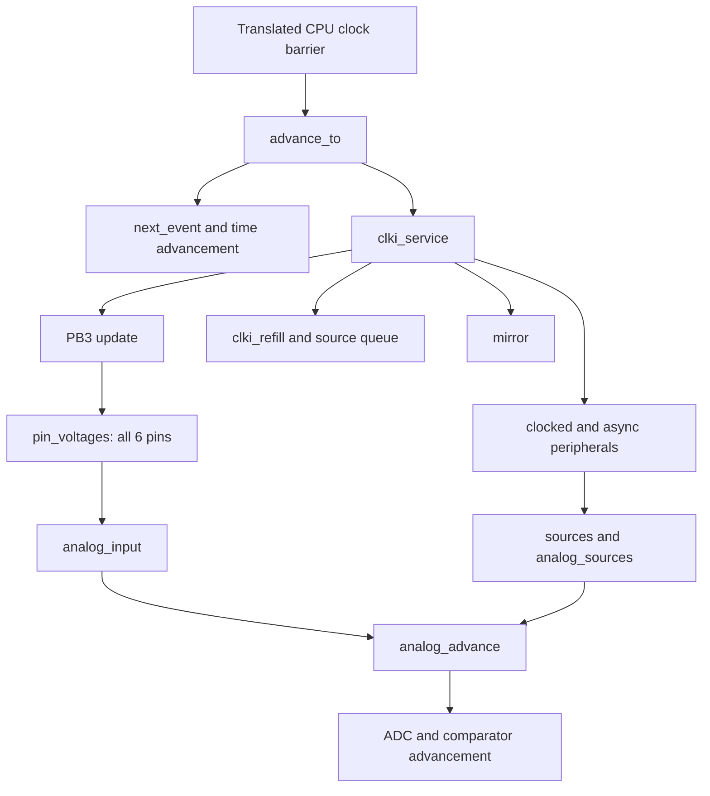

# Current runtime profile and call trace, 2026-10-23

The repeated cost is in native device scheduling, time conversion and peripheral
updates. On the three real firmware excerpts, `next_event` has the largest
individual leaf-frame observation (10–13%). Generated CPU functions/drivers
account for about15% of leaf samples. The full CLKI path also propagates every
source transition through all six analog pin inputs:25ms at20MHz makes6000000
`analog_input` entries and13005922–13902406 `analog_adc_advance` entries, even
though this kernel does not enable the ADC.

These findings identify concrete work to reduce. They are not a measured speedup
or exact exclusive subsystem timings. Production emulator behavior is unchanged.

## Evidence and method

The measured implementation is `be008fa` on `codex/avr-to-wasm`; the native
runtime is unchanged from the preceding benchmark:112340bytes, no host imports,
SHA-256 `ae66ad2e64f8e96af046cd02b04f49c82c371026b8686bd54647678c8a8efa97`.
Host: AMD Ryzen5 5600X, Windows x64, Node22.22.3/V8 12.4.254.21-node.56.

Eight cases each received five sequential fresh-state CPU profiles:40 profiles,
12566 samples with the relevant public `capturePhysical`/`run` ancestor.
The requested interval was500us; observed median deltas were1004–1038us.
Construction, compilation, input submission, hashing and state comparison were
outside the sampling window. No parallel benchmark was launched by these tools.
V8 tiering, profiler overhead and other host load remain in the measurements.

The profiler rebuilds the original Clang/wasm-opt `-O3` runtime, verifies every
byte against production, and uses its optimized function map. Diagnostic WASM
names are metadata only; all executable sections remain identical. Every
profiled run matches the production reference byte for byte for PCM, complete
visible data/Flash/EEPROM, public state and IRQ frames. This validates diagnostic
equivalence for these inputs, not hardware fidelity.

A separate diagnostic build counts source-level function entries, including
functions later inlined by O3. Counters reset immediately before the public
capture calls; initialization and source submission are excluded. It records
the first256 selected function entries in chronological order with integer board
time and CPU-half counters. These instrumented executable bytes and memory layout
differ from production, so their elapsed times are never used for the production
percentages. All five counter/trace cases match production PCM and full final
CPU/device/memory observations.

- [Pooled profiles, provenance and all-repeat hashes](runtime-profile-20261023/summary.json).
- [Exact source-entry counts and chronological prefixes](runtime-profile-20261023/call-counts-and-prefix.json).
- [Optimized native function/index map](runtime-profile-20261023/runtime-functions.json).

One raw `.cpuprofile` per case is retained below; all40 raw profiles, individual
summaries, maps and diagnostic WASM remain under ignored `build/profiles/`.
Load a `.cpuprofile` in a DevTools JavaScript CPU-profile viewer to inspect its
call tree/flame chart. Each representative is one repeat; percentages in this
report pool all five repeats, whose original paths and SHA-256 hashes are retained.

## Real firmware excerpts

These reproduce the250ms/12000-frame/48kHz excerpts from the previous benchmark,
with `fastIdle:true,optimizeFlags:true`, compatible fixed-source full-device
clock and1024-frame capture calls. This profile includes physical pin integration
and wrapper copying; JS DSP is not run. Median profiled times were310.4ms for
rhythmic,353.8ms for stereo and571.8ms for speech. Use the
[unprofiled benchmark](emulator-speed-20261023.md) for speed estimates.

All percentages below are pooled **self/leaf sample** observations:

| Function or disjoint function group | rhythmic | lumiere-stereo | hq4-chego-auto |
| --- | ---: | ---: | ---: |
| `next_event` | 10.1% | 12.2% | 12.6% |
| `ratio` + `duration`, integer time conversions | 12.7% | 11.6% | 9.9% |
| `mirror`, publishing peripheral registers | 5.7% | 4.0% | 3.9% |
| `full_audio_collect`, native pin integration | 4.0% | 3.4% | 3.5% |
| All generated CPU functions/drivers | 15.5% | 14.7% | 14.9% |

The broader native board-function ownership category accounts for51.0–52.7%
of leaf samples. It includes inlined work belonging to other components and is
not an exclusive scheduler timer. JavaScript wrapper leaf samples are0.04–0.10%.
The previous benchmark separately timed JS DSP below0.3ms per250ms of audio.

The counters show why modest individual costs accumulate. Counts cover one250ms
excerpt, not a complete composition:

| Source-level entries | rhythmic | lumiere-stereo | hq4-chego-auto |
| --- | ---: | ---: | ---: |
| `next_event` including cache hits | 4196927 | 3917128 | 5858601 |
| `next_event_scan` | 1467609 | 1389765 | 2013105 |
| `ratio` | 5660629 | 5313174 | 7896991 |
| `duration` | 2522297 | 2498868 | 3486210 |
| `mirror` | 1454572 | 1376728 | 2003731 |
| `analog_adc_advance` | 4506344 | 4431250 | 6177657 |
| `full_audio_collect` | 1367637 | 1260811 | 1939447 |

The existing same-timestamp deadline cache does get reused: `next_event` entries
substantially exceed actual scans. Nevertheless, millions of scans, conversions,
register publications and same-time peripheral checks remain in a short excerpt.

Representative raw profiles:
[rhythmic](runtime-profile-20261023/rhythmic.cpuprofile),
[stereo](runtime-profile-20261023/lumiere-stereo.cpuprofile),
[speech](runtime-profile-20261023/hq4-chego-auto.cpuprofile).

## Direct instruction kernel

The source-only kernel is the same `ADD; EOR; INC; RJMP` loop as the speed
benchmark. Each profile runs1000000 instructions in one public call, with idle
skipping disabled. No audio capture or filtering runs in these two cases.
The profile harness explicitly requests CLKPR/D1 before timing; the steady
instruction loop is unchanged, and its production reference has the same setup.

| Case | Samples | `next_event` self | `ratio` self | `mirror` self | Generated CPU bodies |
| --- | ---: | ---: | ---: | ---: | ---: |
| Full compatible clock | 749 | 10.3% | 10.3% | 8.0% | 12.8% |
| Full physical continuation | 1457 | 12.5% | 8.3% | 8.6% | 11.1% |

This corroborates the scheduler/register work in a kernel with no enabled PWM
or ADC. Native phase-clock/advance wrappers are additional visible frames in
the physical case; their inclusive descendants overlap with the scheduler.
These observations do not isolate the exact cause of the total difference
between the two execution modes.

Representative profiles:
[compatible direct](runtime-profile-20261023/kernel-compatible-div1-direct.cpuprofile),
[physical direct](runtime-profile-20261023/kernel-physical-div1-direct.cpuprofile).

## Full external CLK

The kernel capture cases match the25ms/1200-frame/48kHz benchmark, including the
initial protected CLKPR write. The source has20MHz frequency,50% duty and no
optional electrical validator. PB1 stays low, but PB3/source levels, dividers,
GPIO sampling, native pin records and CPU continuations are fully active.

The same1000000 source transitions remain present at /1 and /256. Source-entry
counts below exclude constructors and input submission:

| Function | /1 | /256 |
| --- | ---: | ---: |
| Retired AVR instructions | 400001 | 1564 |
| `pin_voltages` | 1000000 | 1000000 |
| `analog_input` | 6000000 | 6000000 |
| `analog_advance` | 8601604 | 8003948 |
| `analog_adc_advance` | 13902406 | 13005922 |
| `analog_comparator_advance` | 14601604 | 14003948 |
| `next_event_scan` | 1300803 | 1001975 |
| `mirror` | 1300802 | 1001974 |
| `clki_refill` | 1000000 | 1000000 |

The corresponding pooled leaf-frame ownership observations are:

| Function ownership group | /1 | /256 |
| --- | ---: | ---: |
| Native board bodies | 43.5% | 41.0% |
| Native analog bodies | 25.0% | 34.7% |
| Visible CLKI queue/divider/producer bodies | 7.3% | 8.8% |
| Native pin propagation/capture bodies | 4.8% | 6.8% |
| Generated CPU functions/drivers | 4.5% | 0.2% |
| Native audio integration bodies | 2.1% | 0.5% |

`pin_voltages` has21.1% inclusive samples at /1 and29.7% at /256, including
`analog_input` and its descendants. Those inclusive values overlap with the
analog-body row and must not be added to it. O3 inlines parts of `clki_service`
into the containing board frames; visible CLKI-function samples alone do not
represent the complete cost of the clock model.

The source-backed call path explains the amplification:



This is a logical call graph, not the equal-timestamp event-order specification.
The chronological prefix is retained separately in the counter trace.

For example, its first source edge is at25000ps. Entries40–111 show
`pin_voltages`, six `analog_input` entries and repeated ADC/comparator advances
at that same board timestamp, before the delivered CPU-half counter changes.
This gives a concrete chronology for the amplification shown by the totals.

In [clki_board.inc](../native/devices/attiny13a/clki_board.inc), each source
transition updates PB3 and unconditionally calls
[pin_voltages](../native/peripherals/device.c). That function loops over all six
pins. Each [analog_input](../native/peripherals/analog.c) advances analog state
before applying a voltage, even when that pin's value is unchanged. The normal
clock service and source-flag propagation advance analog state again. Counting
confirms these repeated entries; it does not establish that every entry is safe
to remove.

Representative raw profiles:
[CLKI /1](runtime-profile-20261023/kernel-clki-div1-capture.cpuprofile),
[CLKI /256](runtime-profile-20261023/kernel-clki-div256-capture.cpuprofile),
[matching internal source](runtime-profile-20261023/kernel-physical-div1-capture.cpuprofile).

## Prioritized follow-up experiments

1. Propagate only changed pin voltages and coalesce redundant analog work at the
   same timestamp. Preserve ADC/comparator sampling before mutations, triggers,
   VCC/reference changes and PB3/ADC3 observations. Measure each change against
   exact pin/PCM/state parity, including source/reset ties and disabled domains.
2. Reduce repeated deadline scans/conversions when the next event and its clock
   mapping are proven unchanged. CLKI also requires independent async deadlines;
   synchronous events must still be delivered on their actual source phases.
3. Publish dirty I/O registers at proven observable boundaries rather than
   repeatedly mirroring all fields. Include translated memory-mapped accesses,
   interrupt flags, direct host observations and protected write windows.
4. Investigate the periodic producer/queue and redundant protected-window checks
   after the dominant analog/scheduler work. Periodic-source fast-forward must
   retain divider residues and every requested pin/sample/event observation.

These are proposed experiments, not implemented optimizations or predicted
speedup factors. Native audio filtering and AVR arithmetic lowering are lower
priorities in these profiles. Exact exclusive subsystem timings and the
default-engine performance gate remain open in [the plan](../native/ATTINY13A_PLAN.md).

## Reproduce

Run serially from the worktree root with the read-only prepared SDK:

```powershell
node web-player/scripts/profile-device.mjs --frames 12000 --repeats 5 --interval-us 500 --out-dir build/profiles/current-firmware
node web-player/scripts/profile-device.mjs --kernel --clock compatible --operation direct --frequency 9600000 --repeats 5 --interval-us 500 --out-dir build/profiles/kernel-compatible-direct
node web-player/scripts/profile-device.mjs --kernel --clock physical --operation direct --frequency 9600000 --repeats 5 --interval-us 500 --out-dir build/profiles/kernel-physical-direct
node web-player/scripts/profile-device.mjs --kernel --clock physical --frequency 20000000 --frames 1200 --repeats 5 --interval-us 500 --out-dir build/profiles/kernel-internal-20m
node web-player/scripts/profile-device.mjs --kernel --clock clki --frequency 20000000 --frames 1200 --repeats 5 --interval-us 500 --out-dir build/profiles/kernel-clki-20m-div1
node web-player/scripts/profile-device.mjs --kernel --clock clki --frequency 20000000 --divisor 256 --frames 1200 --repeats 5 --interval-us 500 --out-dir build/profiles/kernel-clki-20m-div256
node web-player/scripts/trace-device-calls.mjs
node web-player/scripts/analyze-device-profiles.mjs --out-dir web-player/reports/runtime-profile-20261023
```

Profiling output depends on the current native artifact; the same-O3 rebuild
must match its bytes before names or sampled percentages are accepted. No MIDI
or raw audio files were created. Instrumented source copies and diagnostic WASM
stay under ignored `build/`; official manufacturer definitions are read unchanged.
